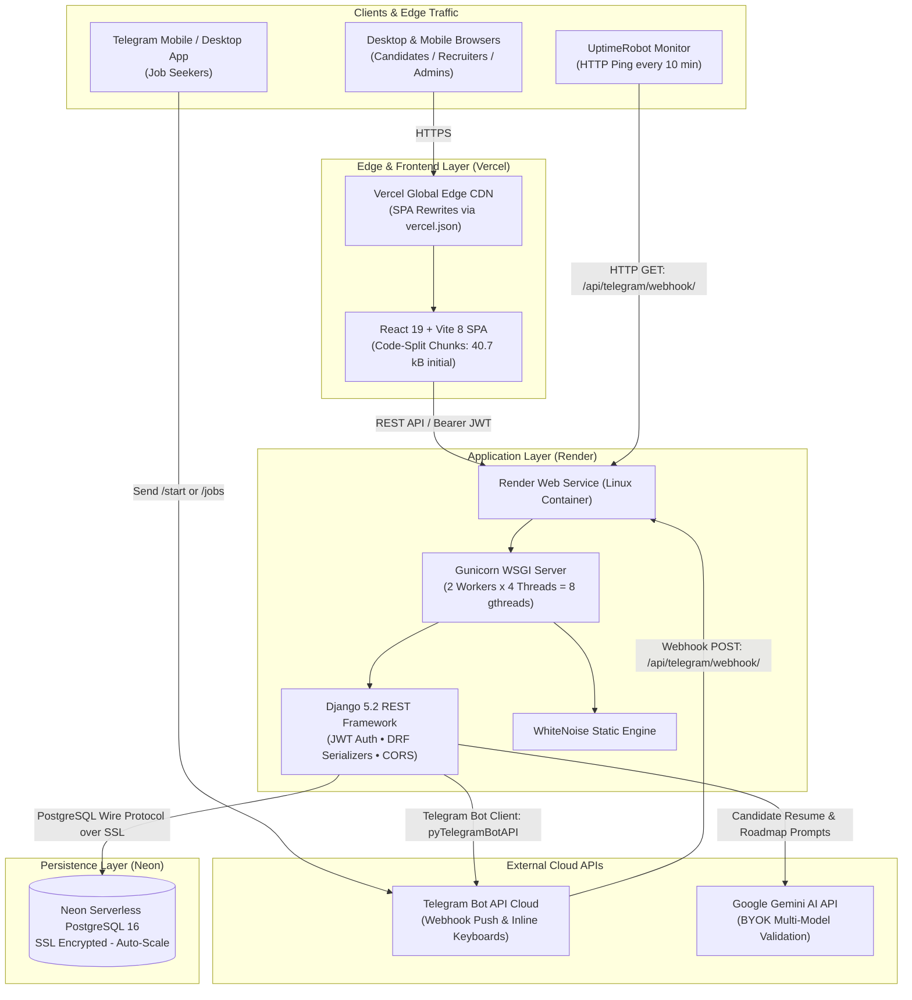
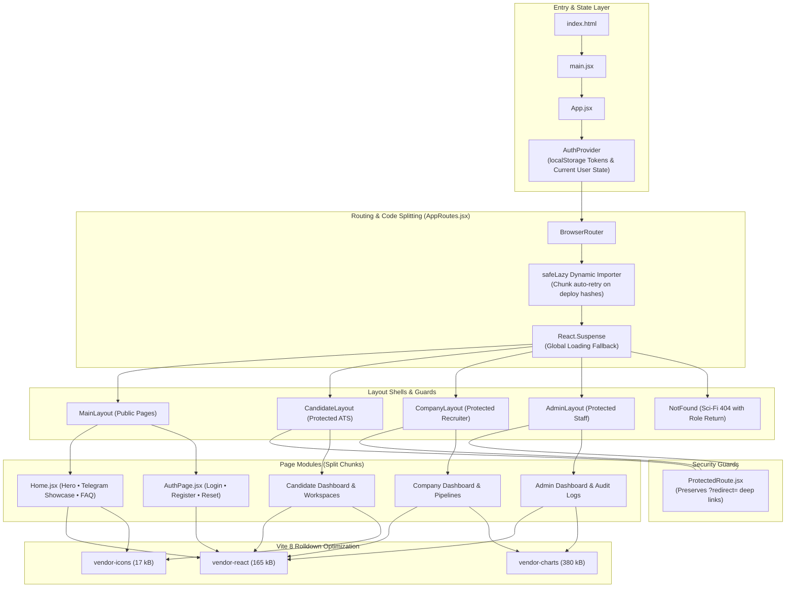
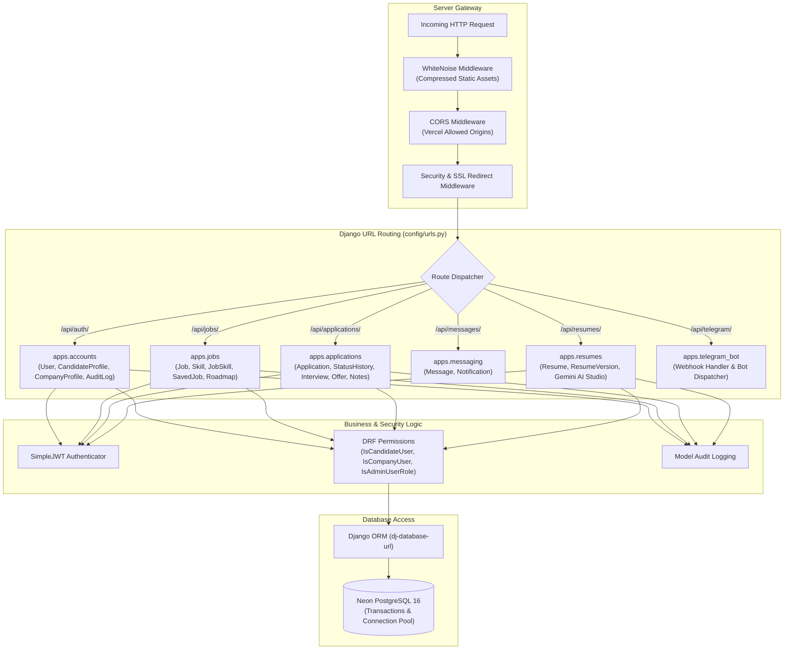
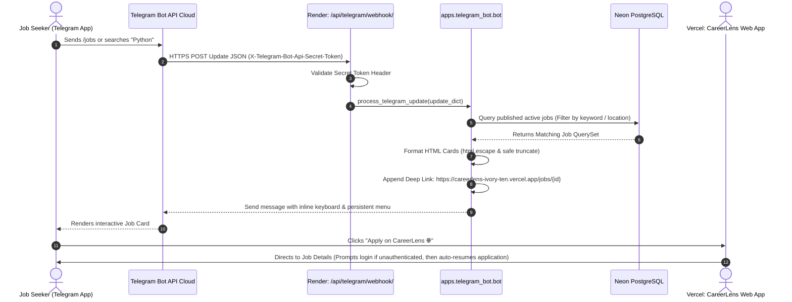
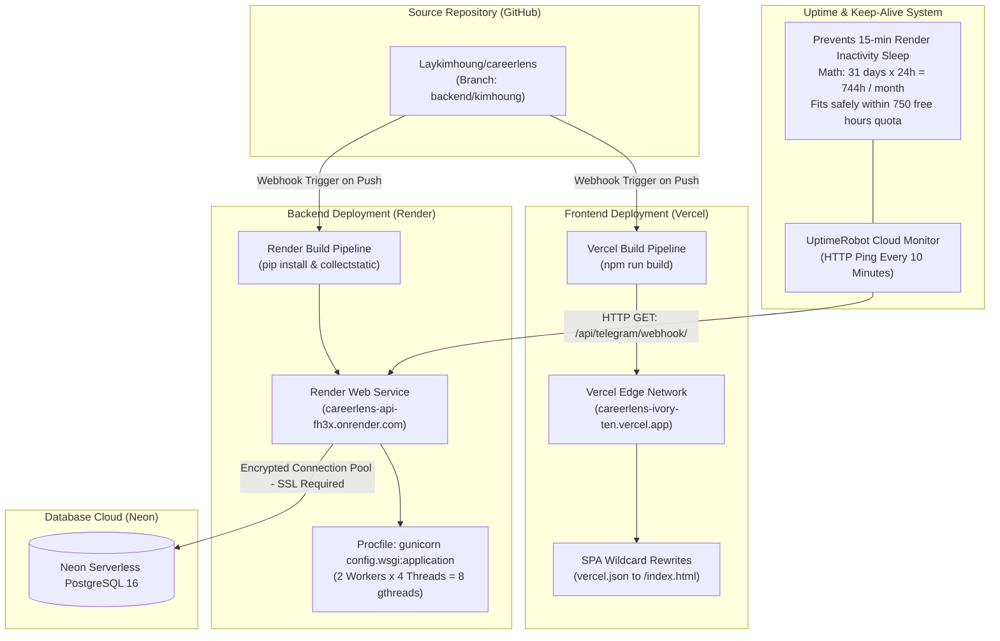

<p align="center">
  
</p>

# 🎓 CareerLens

> **Full-Stack University Recruitment & Applicant Tracking System (ATS)**

A modern full-stack recruitment platform engineered to connect university students, graduates, and tech employers. Streamlines the hiring lifecycle from job discovery and application tracking to technical interviews, job offers, resume diagnostics, and an interactive 24/7 Telegram recruitment bot.

         

---

## 📑 Table of Contents

- [🚀 Live Production Deployments](#-live-production-deployments)
- [👥 Development Team & Responsibilities](#-development-team--responsibilities)
- [🌟 Key Features](#-key-features)
- [📐 System Architectures](#-system-architectures)
  - [1. Full System Architecture](#1-full-system-architecture)
  - [2. Frontend Architecture](#2-frontend-architecture)
  - [3. Backend Architecture](#3-backend-architecture)
  - [4. Telegram Bot Architecture](#4-telegram-bot-architecture)
  - [5. Deployment & DevOps Architecture](#5-deployment--devops-architecture-with-uptimerobot-keep-alive)
- [🛠️ Technology Stack](#️-technology-stack)
- [📂 Project Architecture & Directory Structure](#-project-architecture--directory-structure)
- [📋 Prerequisites](#-prerequisites)
- [⚡ Quick Start Guide](#-quick-start-guide)
  - [Terminal Navigation Guide](#terminal-navigation-guide-backend-vs-frontend)
  - [Step 1: Clone the Repository](#step-1-clone-the-repository)
  - [Step 2: Database Setup (PostgreSQL)](#step-2-database-setup-postgresql)
  - [Step 3: Backend Setup](#step-3-backend-setup-terminal-1--cd-backend)
  - [Step 4: Frontend Setup](#step-4-frontend-setup-terminal-2--cd-frontend)
- [🎯 Demo Accounts & Ready-to-Test Dataset](#-demo-accounts--ready-to-test-dataset)
- [🤖 Telegram Bot Quick Start](#-telegram-bot-quick-start)
- [🛠️ Django Management Commands](#️-django-management-commands)
- [🧪 Running Automated Tests](#-running-automated-tests)
- [📚 In-Depth Documentation](#-in-depth-documentation)
- [📄 License & University Context](#-license--university-context)

---

## 🚀 Live Production Deployments

| Component | Platform | Live URL / Handle | Status |
| :--- | :--- | :--- | :--- |
| **Frontend Web App** | Vercel (Edge CDN) | [https://careerlens-ivory-ten.vercel.app](https://careerlens-ivory-ten.vercel.app) | 🟢 Live |
| **Backend REST API** | Render (Web Service) | [https://careerlens-api-fh3x.onrender.com](https://careerlens-api-fh3x.onrender.com) | 🟢 Live |
| **Telegram Bot** | Telegram Cloud | [@careerlens_jobs_bot](https://t.me/careerlens_jobs_bot) | 🟢 Active |
| **Database** | Neon Serverless | Hosted PostgreSQL 16 over SSL (`sslmode=require`) | 🟢 Connected |
| **Keep-Alive Monitor** | UptimeRobot | Pings every 10 min (Prevents Render cold starts) | 🟢 Active (100% Uptime) |

---

## 👥 Development Team & Responsibilities

The CareerLens platform was engineered by a specialized team of **3 developers**:

```text
┌─────────────────────────────────────────────────────────────────────────┐
│                    Lay Kimhoung (Team Leader)                           │
│  Backend REST API • PostgreSQL Database • Telegram Bot • DevOps/Deploy  │
│                   & Supporting Frontend Architecture                    │
└───────────────────┬─────────────────────────────────┬───────────────────┘
                    │                                 │
                    ▼                                 ▼
       ┌─────────────────────────┐       ┌─────────────────────────┐
       │        Eiv Youe         │       │        Sokun En         │
       │   Frontend Engineer     │       │   Frontend Engineer     │
       │  All Dashboards & ATS   │       │ Landing Page & Auth Flow│
       │(Candidate/Company/Admin)│       │  (Home, Login, Register)│
       └─────────────────────────┘       └─────────────────────────┘
```

| Member | Role | Primary Responsibilities | Owned Scope & Key Files |
| :--- | :--- | :--- | :--- |
| **Lay Kimhoung**<br>*(Team Leader)* | Lead Architect,<br>Backend & DevOps | • Django 5.2 REST API architecture & modular app design<br>• Database schema, indexing, migrations & idempotent seeders<br>• Telegram Bot integration (`@careerlens_jobs_bot`) & webhook<br>• Cloud deployment (Vercel, Render, Neon, UptimeRobot 24/7)<br>• Supporting Frontend: `safeLazy` code splitting, `ProtectedRoute` deep linking, BYOK Gemini AI validation | `backend/apps/` (all apps)<br>`backend/config/`<br>`backend/Procfile`<br>`frontend/src/routes/AppRoutes.jsx`<br>`frontend/src/components/common/ProtectedRoute.jsx`<br>`frontend/vercel.json`<br>`frontend/vite.config.js` |
| **Eiv Youe** | Frontend Engineer | • Candidate ATS Dashboard (Applications, Status tracker, Saved jobs)<br>• Recruiter ATS Workspace (Job management, Applicant pipeline, Interview scheduler, Offer management)<br>• Administrator Management Portal (User directory, Platform KPIs, Audit logs) | `frontend/src/pages/candidate/`<br>`frontend/src/pages/company/`<br>`frontend/src/pages/admin/`<br>`frontend/src/components/candidate/`<br>`frontend/src/components/company/`<br>`frontend/src/components/admin/` |
| **Sokun En** | Frontend Engineer | • Public Landing Page (`Home.jsx`) with responsive layout & dark/light theme<br>• Interactive Telegram Bot showcase with simulated chat<br>• Authentication flow (`AuthPage.jsx`: Login, Register, Password Reset, Role Switcher)<br>• Public navigation bar and footer | `frontend/src/pages/landing/Home/`<br>`frontend/src/pages/auth/`<br>`frontend/src/components/landing/`<br>`frontend/src/layouts/MainLayout.jsx` |

---

## 🌟 Key Features

- **Role-Based Access Control (RBAC)**: Secure stateless JWT authentication supporting dedicated roles: `CANDIDATE`, `COMPANY`, and `ADMIN`.
- **Telegram Bot Assistant (`@careerlens_jobs_bot`)**:
  - Live Telegram bot enabling students to discover jobs, browse vacancies, and search by keywords directly on mobile.
  - Interactive deep links direct candidates straight to the job application page on the web app.
  - Interactive landing page showcase with live status indicator and light/dark mode support.
- **Google Gemini AI Integration (Bring-Your-Own-Key)**:
  - Universal multi-model Gemini support (`gemini-3.5-flash-lite`, `gemini-3.8-flash`) for automated resume analysis and tailored career roadmaps.
  - Zero-paywall BYOK architecture allowing candidates to input their own free Gemini API key.
- **Enterprise-Grade ATS Pipeline**:
  - Full candidate lifecycle: `APPLIED` $\to$ `REVIEWING` $\to$ `INTERVIEW` $\to$ `OFFERED` $\to$ `REJECTED`.
  - Recruiter interview scheduling with Google Meet/Zoom links and formal offer generation.
- **High-Performance Frontend**:
  - Dynamic route code-splitting via `safeLazy` reduces initial bundle size from **1.36 MB down to 40.7 kB** (97% reduction).
  - Rollup vendor chunking (`vendor-react`, `vendor-charts`, `vendor-icons`).
  - Auto-recovering `<Suspense>` boundary protects against stale chunk hashes on new deployments.
  - Smart post-auth deep-link preservation (`?redirect=...`).
  - Futuristic Sci-Fi 404 page (`/404` and wildcard `*`) with role-aware return navigation.
- **24/7 Cloud Architecture with Zero Cold Starts**:
  - Multi-threaded Gunicorn (`gthread` with 2 workers and 4 threads = 8 concurrent request handlers).
  - Continuous UptimeRobot keep-alive monitor pings the Render service every 10 minutes, keeping the server perpetually awake within the free 750 monthly hours limit.

---

## 📐 System Architectures

### 1. Full System Architecture



---

### 2. Frontend Architecture



---

### 3. Backend Architecture



---

### 4. Telegram Bot Architecture



---

### 5. Deployment & DevOps Architecture (with UptimeRobot Keep-Alive)



---

## 🛠️ Technology Stack

| Layer | Technologies | Description |
| :--- | :--- | :--- |
| **Backend API** | Python 3.12, Django 5.2, Django REST Framework, SimpleJWT | High-speed RESTful API with modular architecture and role-based permissions |
| **Concurrency** | Gunicorn with `gthread` (2 workers $\times$ 4 threads) | Handles 8 concurrent requests simultaneously with 120s timeout |
| **Database** | PostgreSQL 16 (Neon Serverless), Psycopg 3 | Serverless relational database with SSL encryption and automated branching |
| **Frontend UI** | React 19, Vite 8, Tailwind CSS v4, Axios, React Router v7 | Single-page application with dynamic code-splitting and responsive layout |
| **Telegram Bot** | pyTelegramBotAPI (`telebot`), Telegram Bot Webhook | Mobile recruitment bot with natural language search and deep links |
| **Artificial Intelligence**| Google Gemini API (`@google/genai`, REST) | Multi-model Bring-Your-Own-Key resume analyzer and career roadmap generator |
| **DevOps & Monitoring** | Vercel Edge CDN, Render Linux Web Service, UptimeRobot | Zero-cost production infrastructure with 24/7 uptime monitoring |

---

## 📂 Project Architecture & Directory Structure

```text
CareerLens/
├── backend/                       # Django REST API application
│   ├── apps/
│   │   ├── accounts/              # User accounts, CandidateProfile, CompanyProfile, AuditLog
│   │   │   └── management/        # Seeding commands (seed_demo_data, clear_demo_data)
│   │   ├── jobs/                  # Jobs, Skills, JobSkills, SavedJobs, Career Roadmap
│   │   ├── applications/          # Applications, Status History, Interviews, Offers, Notes
│   │   ├── messaging/             # Direct Messages and Notifications
│   │   ├── resumes/               # Resume upload, Gemini AI Analyzer, CV Studio, Versions
│   │   └── telegram_bot/          # Telegram Bot webhook, command router, message formatters
│   ├── config/                    # Django project configuration (settings.py, urls.py, wsgi.py)
│   ├── media/                     # Uploaded media (resumes, avatars)
│   ├── staticfiles/               # WhiteNoise collected static assets
│   ├── Procfile                   # Multi-threaded Gunicorn production deployment command
│   ├── requirements.txt           # Python dependencies
│   ├── .env.example               # Backend environment variables template
│   └── manage.py                  # Django CLI entry point
├── frontend/                      # React 19 + Vite 8 frontend application
│   ├── src/
│   │   ├── components/            # Reusable UI components (candidate, company, admin, landing)
│   │   ├── context/               # AuthContext global state
│   │   ├── layouts/               # MainLayout, CandidateLayout, CompanyLayout, AdminLayout
│   │   ├── pages/                 # Route pages (Home, AuthPage, Dashboards, Sci-Fi NotFound)
│   │   ├── routes/                # AppRoutes.jsx with safeLazy dynamic code splitting
│   │   └── services/              # API clients and HTTP interceptors
│   ├── vercel.json                # Vercel SPA route rewrite rules
│   ├── vite.config.js             # Vite 8 config with vendor chunk optimization
│   ├── package.json               # Node.js dependencies
│   └── .env.example               # Frontend environment template
├── docs/                          # In-depth architectural documentation
│   ├── DEPLOYMENT.md              # Vercel + Render + Neon + UptimeRobot guide
│   ├── FRONTEND_ARCHITECTURE.md   # Component hierarchy, lazy loading, deep links
│   ├── API.md                     # Comprehensive REST API and Telegram Webhook reference
│   ├── DATABASE.md                # Relational schema, ERD, and table definitions
│   └── TEAM_WORKFLOW.md           # 3-developer team workflow, ownership, and Git rules
└── README.md                      # Root documentation and quick-start guide
```

---

## 📋 Prerequisites

Before running CareerLens locally, ensure you have installed:

1. **Git**: [Download Git](https://git-scm.com/)
2. **Python** (version 3.10 to 3.12+): [Download Python](https://www.python.org/downloads/)
3. **Node.js** (version 18.x or 20.x+) & **npm**: [Download Node.js](https://nodejs.org/)
4. **PostgreSQL** (version 14 or higher): [Download PostgreSQL](https://www.postgresql.org/download/) or run via Docker.

---

## ⚡ Quick Start Guide

### Terminal Navigation Guide (Backend vs. Frontend)

> [!IMPORTANT]
> **Understanding Full-Stack Terminals**:
> CareerLens consists of **two independent applications** that communicate over HTTP and must run at the same time:
> 1. **Backend (Django REST API)** $\longrightarrow$ Located in `backend/`
> 2. **Frontend (React + Vite UI)** $\longrightarrow$ Located in `frontend/`
>
> You will need **two separate terminal windows** open side-by-side:
>
> | Task / Command | Which Directory to `cd` into? | Which Terminal? | Example Commands |
> | :--- | :--- | :--- | :--- |
> | **Python / Django / Database** | `cd backend` | **Terminal 1** (Backend) | `python manage.py migrate`<br>`python manage.py seed_demo_data`<br>`python manage.py runserver` |
> | **Node / React / Vite UI** | `cd frontend` | **Terminal 2** (Frontend) | `npm install`<br>`npm run dev` |

---

### Step 1: Clone the Repository

```bash
git clone https://github.com/Laykimhoung/careerlens.git
cd CareerLens
```

---

### Step 2: Database Setup (PostgreSQL)

Make sure your PostgreSQL service is running. Create a dedicated database:

```sql
CREATE DATABASE careerlens_db;
```

---

### Step 3: Backend Setup (Terminal 1 — `cd backend`)

1. **Navigate to the backend directory**:
   ```bash
   cd backend
   ```

2. **Create and activate a virtual environment**:
   - **Windows**:
     ```bash
     python -m venv .venv
     .venv\Scripts\activate
     ```
   - **macOS / Linux**:
     ```bash
     python3 -m venv .venv
     source .venv/bin/activate
     ```

3. **Install Python dependencies**:
   ```bash
   pip install --upgrade pip
   pip install -r requirements.txt
   ```

4. **Configure Environment Variables**:
   Copy the example environment file:
   - **Windows (PowerShell)**: `Copy-Item .env.example .env`
   - **macOS / Linux**: `cp .env.example .env`

   Edit `backend/.env` with your database credentials:
   ```env
   SECRET_KEY=your-secure-random-secret-key
   DEBUG=True
   ALLOWED_HOSTS=localhost,127.0.0.1

   DB_NAME=careerlens_db
   DB_USER=postgres
   DB_PASSWORD=your_postgres_password
   DB_HOST=127.0.0.1
   DB_PORT=5432

   # Optional Telegram bot token (for local bot polling)
   # TELEGRAM_BOT_TOKEN=your_telegram_bot_token_from_botfather
   ```

5. **Apply Database Migrations**:
   ```bash
   python manage.py migrate
   ```

6. **Seed Realistic Demo Data**:
   Populate the database with a pre-configured, realistic dataset (24 IT jobs across 9 companies, 5 candidates, applications, interviews, offers, and direct messages):
   ```bash
   python manage.py seed_demo_data
   ```

7. **Start the Django Development Server**:
   ```bash
   python manage.py runserver
   ```
   The backend API is now running at: **`http://127.0.0.1:8000/`**

---

### Step 4: Frontend Setup (Terminal 2 — `cd frontend`)

1. **Open a new terminal window** and navigate to `frontend/`:
   ```bash
   cd frontend
   ```

2. **Install Node dependencies**:
   ```bash
   npm install
   ```

3. **Configure Frontend Environment**:
   Copy the example environment file:
   - **Windows (PowerShell)**: `Copy-Item .env.example .env`
   - **macOS / Linux**: `cp .env.example .env`

   Verify `frontend/.env` contains:
   ```env
   VITE_API_URL=http://127.0.0.1:8000/api
   ```

4. **Start the Vite Development Server**:
   ```bash
   npm run dev
   ```
   The frontend is now running at: **`http://localhost:5173/`**

---

## 🎯 Demo Accounts & Ready-to-Test Dataset

When you run `python manage.py seed_demo_data`, the platform seeds predefined demo accounts:

- **Universal Demo Password:** `CareerLens2026!Demo`

### 1. Candidate Accounts
| Username | Candidate Name | Education / Major | Pre-loaded Features |
| :--- | :--- | :--- | :--- |
| `demo_cand_sreymom` | **Sreymom Meas** | RUPP — Computer Science | Scheduled interview & accepted job offer from Mekong Digital Labs |
| `demo_cand_vireak` | **Vireak Chan** | CADT — Software Engineering | Scheduled interview with Wing Bank |
| `demo_cand_dara` | **Dara Sok** | ITC — Data Science & AI | Active offer ($1,400 USD) from Angkor AI Technologies |
| `demo_cand_bopha` | **Bopha Keo** | Paragon — Cybersecurity | Interview scheduled with Cellcard; 1 under review |
| `demo_cand_piseth` | **Piseth Lim** | NUM — Information Technology | Active applications for IT Intern and Software Tester |

### 2. Company Recruiter Accounts
| Username | Company | Category | Roles Posted |
| :--- | :--- | :--- | :--- |
| `demo_comp_mekong` | **Mekong Digital Labs** | Tech Studio | Frontend Dev, Full-Stack Dev, Junior Web Dev, UI/UX Designer |
| `demo_comp_smart` | **Smart Axiata** | Telecom | Network Engineer, System Administrator |
| `demo_comp_cellcard` | **Cellcard** | Telecom | Cybersecurity Analyst, IT Support Engineer |
| `demo_comp_aba` | **ABA Bank** | FinTech | Mobile App Developer, Security Engineer |
| `demo_comp_wing` | **Wing Bank** | FinTech | Backend Developer, DevOps Engineer |
| `demo_comp_1byte` | **1Byte** | Cloud Provider | Cloud Engineer, Database Administrator |
| `demo_comp_khmercloud`| **KhmerCloud Solutions** | Cloud Firm | Software Engineer, QA Engineer, Software Tester |
| `demo_comp_angkor` | **Angkor AI Technologies** | AI Lab | Data Analyst, Data Engineer, ML Engineer, AI Engineer |
| `demo_comp_ppcyber` | **Phnom Penh CyberSec** | Cyber Security | BI Analyst, Technical Support Specialist, IT Intern |

### 3. Administrator Account
| Username | Role | Permissions | Default Password |
| :--- | :--- | :--- | :--- |
| `demo_admin` | `ADMIN` (`is_staff=True`) | Superuser/Staff access for Django Admin and audit verification | `CareerLens2026!Demo` |

---

## 🤖 Telegram Bot Quick Start

The CareerLens Telegram Bot (`@careerlens_jobs_bot`) allows mobile users to search and discover IT jobs instantly.

1. Open Telegram and search for **`@careerlens_jobs_bot`** or visit: [t.me/careerlens_jobs_bot](https://t.me/careerlens_jobs_bot)
2. Press **Start** or send `/start` to view the welcome guide and persistent keyboard.
3. Available commands:
   - `/jobs` — Browse latest 5 published IT vacancies.
   - `/search <keyword>` — Search jobs by title, skill, or tech stack (e.g., `/search Python` or `/search React`).
   - `/help` — View available commands and tips.
4. Tap **Apply on CareerLens 🌐** on any job card to jump directly to the job application on the web app!

---

## 🛠️ Django Management Commands

All commands below must be executed from the **`backend/`** directory:

```bash
# Seed complete 24-job demo dataset (safe and idempotent)
python manage.py seed_demo_data

# Inspect tracked demo records without modifying data
python manage.py clear_demo_data --dry-run

# Safely delete demo records in reverse dependency order
python manage.py clear_demo_data --no-input

# Reset demo data to pristine initial state in one line
python manage.py clear_demo_data --no-input && python manage.py seed_demo_data

# Run Telegram bot in long-polling mode (for local testing without webhook)
python manage.py run_telegram_bot
```

---

## 🧪 Running Automated Tests

Run the full Django test suite covering accounts, authentication, jobs, applications, messaging, and the Telegram bot:

```bash
cd backend
python manage.py test apps
```

---

## 📚 In-Depth Documentation

For detailed architectural specifications and design guides, explore the [`docs/`](docs) directory:

- [**Deployment Guide**](docs/DEPLOYMENT.md): Production deployment on Vercel, Render, Neon, and UptimeRobot keep-alive setup.
- [**Frontend Architecture**](docs/FRONTEND_ARCHITECTURE.md): Component hierarchy, dynamic code-splitting, route guards, and theme styling.
- [**API Specification**](docs/API.md): Full REST API endpoint reference, payloads, responses, and Telegram webhook contract.
- [**Database Schema**](docs/DATABASE.md): Relational models, ER diagram, indexing, and cascade delete policies.
- [**Team Workflow & Branching**](docs/TEAM_WORKFLOW.md): 3-developer team responsibilities, file ownership, and Git branching rules.

---

## 📄 License & University Context

CareerLens is developed as a University Capstone Project demonstrating modern Web Application Architecture, REST API Design, Micro-services Integration, and Database Engineering. Real company names mentioned in the demo dataset (Smart Axiata, Cellcard, ABA Bank, Wing Bank, 1Byte) are used solely for educational demonstration purposes; all associated job listings are simulated academic content.
