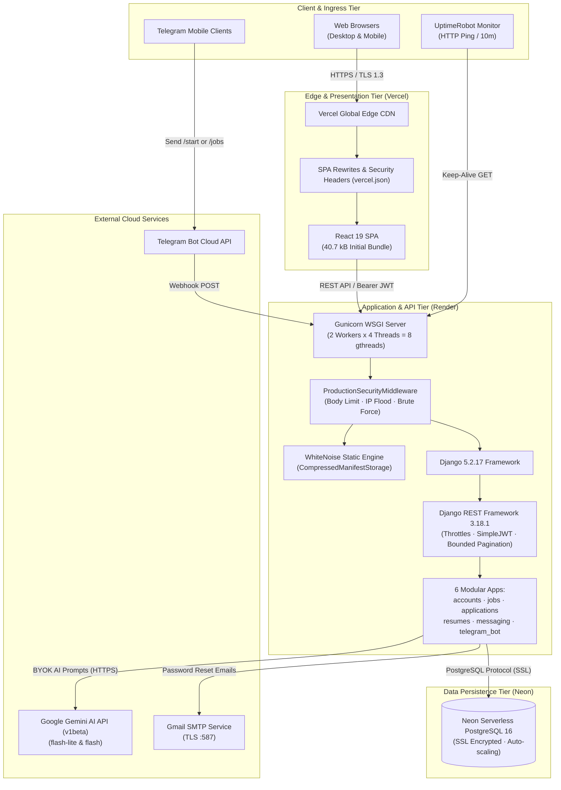
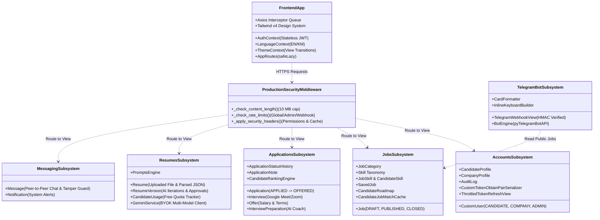
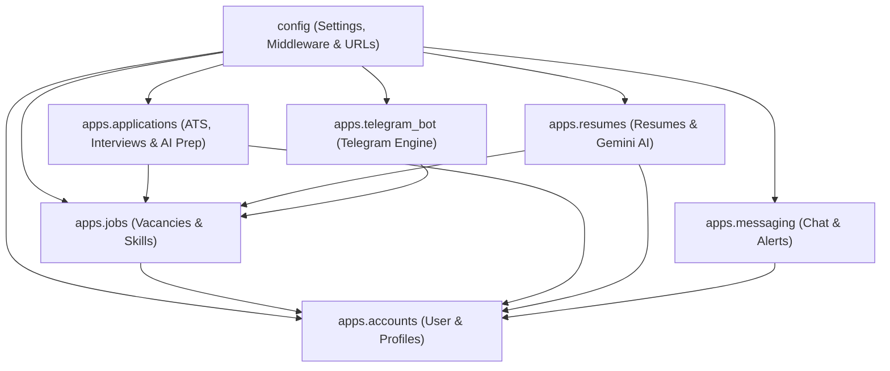
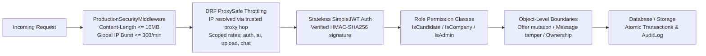

# CareerLens — System Architecture & Technical Design

> **Document Type:** System Architecture Specification  
> **Target Audience:** Lead Architects, Backend & Frontend Engineers, DevOps Specialists, Security Auditors  
> **Status:** Verified from Codebase Implementation  
> **Interactive Visualization:** Available at [architecture.html](file:///d:/Project/University/Website/CareerLens/.archify/architecture-careerlens-20261114-002500/architecture.html)  
> **Last Updated:** 2026-11-14  

---

## 1. Architectural Style & Paradigms

CareerLens is architected as a **decoupled, multi-tier Single-Page Application (SPA) and RESTful API** leveraging cloud-native deployment patterns and defense-in-depth security. 



### Core Design Patterns Applied

1. **Modular Monolithic Backend (Django Apps):**
   - The backend structures business domains into decoupled, cohesive Django apps: `accounts`, `jobs`, `applications`, `resumes`, `messaging`, and `telegram_bot`.
   - Each app encapsulates its own ORM models, serializers, viewsets, URL routers, permission classes, and test suites.
   - Cross-domain interactions occur strictly through foreign keys, standard Python imports, or shared service utilities (`log_audit_action`, `filter_jobs`).

2. **Frontend Service-Repository Pattern:**
   - The React frontend encapsulates all network operations within dedicated service modules (`frontend/src/services/`): `authService.js`, `jobService.js`, `applicationService.js`, `candidateService.js`, `resumeService.js`, `adminService.js`.
   - UI components consume typed service promises, isolating network concerns and response normalization from presentation logic.

3. **Silent Token Refresh with Request Queueing:**
   - Stateless JWT tokens expire automatically (`access`: 7 days, `refresh`: 30 days). An Axios response interceptor intercepts HTTP 401 errors.
   - A concurrency guard (`isRefreshing`) suspends concurrent requests in a promise queue (`failedQueue`), issues a single refresh request to `/api/auth/login/refresh/`, updates the access token, and seamlessly replays pending requests.

4. **Defense-in-Depth Edge & DRF Throttling:**
   - Custom `ProductionSecurityMiddleware` evaluates request payload bounds (`MAX_REQUEST_BODY_BYTES = 10MB` $\to$ HTTP 413) and enforces IP-scoped sliding bucket limits (global burst: 300/min, admin login: 10/min, webhook: 120/min).
   - DRF endpoints utilize proxy-safe throttling (`ProxySafeAnonRateThrottle`, `ProxySafeUserRateThrottle`, `ProxySafeScopedRateThrottle`) resolving client IPs via trusted rightmost `X-Forwarded-For` hops based on `DRF_NUM_PROXIES` to prevent spoofing.

5. **Self-Healing Dynamic Route Splitting (`safeLazy`):**
   - Wraps `React.lazy` with a proprietary `safeLazy` higher-order function in [AppRoutes.jsx](file:///d:/Project/University/Website/CareerLens/frontend/src/routes/AppRoutes.jsx). When a chunk import fails due to a new release replacing hash signatures, it performs an automatic session-bounded page refresh.

6. **Bring-Your-Own-Key (BYOK) Multi-Model AI Pattern:**
   - Avoids centralized AI infrastructure costs by having students supply their own free Google Gemini API key.
   - Keys are validated server-side against Google's API before storage and executed across an automatic model fallback ladder: `gemini-3.5-flash-lite` $\to$ `gemini-3.8-flash`. Powers CV analysis, multi-version improvements, career roadmaps, and the AI Interview Preparation Coach.

7. **Circular View Transitions Theming:**
   - Theme toggling in [ThemeContext.jsx](file:///d:/Project/University/Website/CareerLens/frontend/src/context/ThemeContext.jsx) leverages `document.startViewTransition` with a dynamic radial clip-path animation anchored at the toggle button origin, falling back cleanly when reduced-motion is requested.

---

## 2. Major Components & Subsystem Boundaries



### Component Details & Responsibilities

| Subsystem | Boundary & Hosting | Responsibilities | Key Technologies |
| :--- | :--- | :--- | :--- |
| **Edge Presentation** | Vercel Global Edge CDN | • Serves minified JS, CSS, and media bundles.<br>• Enforces client-side SPA route rewrites via `vercel.json`.<br>• Enforces HSTS, CSP, and X-Frame-Options headers.<br>• Initial page load chunk size optimized to 40.7 kB. | Vercel CDN, HTTP/2, Brotli compression |
| **Frontend SPA Client** | User Browser Environment | • Client-side UI rendering with React 19.<br>• Route guards enforcing candidate, company, and admin authorization.<br>• Bilingual support (English/Khmer) & View Transitions circular theme animation. | React 19, Tailwind v4, Vite 8, Lucide React, Recharts |
| **Edge Security Middleware**| Django Middleware Pipeline | • Content-Length upper bound enforcement (HTTP 413).<br>• Global IP burst, admin login, and webhook flood rate limiting.<br>• Injects `Permissions-Policy` and `Cache-Control: no-store` on auth endpoints. | `ProductionSecurityMiddleware`, Django Cache |
| **API Application Server** | Render Linux Container | • Gunicorn WSGI runtime executing 2 workers x 4 threads (8 concurrent requests).<br>• WhiteNoise static asset serving for Django Admin & DRF browseable API.<br>• Proxy-safe DRF throttles and bounded pagination (`max_page_size=100`). | Python 3.12, Django 5.2, Gunicorn 23, WhiteNoise 6.9 |
| **Relational Database** | Neon Serverless PostgreSQL | • ACID-compliant transactional persistence.<br>• 23 application models with foreign key cascades and uniqueness constraints.<br>• SSL encryption enforced (`sslmode=require`) with connection pooling. | PostgreSQL 16, pgBouncer connection pool |
| **AI Integration Gateway**| Google Cloud Generative Language | • Multi-model resume parsing, ATS scoring, diagnosis, resume generation, and interview coaching.<br>• JSON-mode structured output schema enforcement. | Gemini API v1beta, HTTPS REST |
| **Telegram Mobile Gateway**| Telegram Cloud API | • Webhook push notifications from Telegram users.<br>• Inline keyboards and deep links into web application views.<br>• HMAC secret validation and 1MB webhook payload limit. | pyTelegramBotAPI, Telegram Webhook |
| **Keep-Alive Monitor** | UptimeRobot Cloud | • Periodic HTTP GET ping to `/api/telegram/webhook/` every 10 minutes.<br>• Bypasses Render's 15-minute inactivity spin-down, preventing 50s cold starts. | Automated HTTP Probe |

---

## 3. Communication Protocols & Interfaces

### 1. Client-to-API Communication (HTTPS REST)
- **Protocol:** HTTP/1.1 and HTTP/2 over TLS 1.3.
- **Authentication Scheme:** `Authorization: Bearer <access_token>`.
- **Throttling Scopes:**
  - `anon`: 60/min
  - `user`: 180/min
  - `auth_login`: 10/min
  - `auth_register`: 10/min
  - `auth_password_reset`: 5/min
  - `ai_generation`: 15/min
  - `resume_upload`: 10/min
  - `messaging`: 60/min
- **Pagination Boundary:** [BoundedPageNumberPagination](file:///d:/Project/University/Website/CareerLens/backend/config/pagination.py) enforces `page_size=100` and `max_page_size=100` to prevent memory exhaustion.
- **Payload Format:** `application/json` for standard endpoints; `multipart/form-data` for resume file uploads.
- **Response Headers Added:**
  - `Permissions-Policy: camera=(self), microphone=(self), geolocation=(), payment=(), usb=()`
  - `Cache-Control: no-store, no-cache, must-revalidate, private` (on `/api/auth/` routes)

### 2. Telegram Bot Webhook Communication
- **Protocol:** HTTPS POST push from Telegram Cloud servers.
- **Security Validation:** `X-Telegram-Bot-Api-Secret-Token` verified using constant-time comparison (`hmac.compare_digest`) in [views.py](file:///d:/Project/University/Website/CareerLens/backend/apps/telegram_bot/views.py).
- **Payload Cap:** Max 1 MB payload ceiling (`MAX_WEBHOOK_BODY_BYTES`) to prevent memory exhaustion.

### 3. Keep-Alive Probe Interface
- **Protocol:** HTTP GET targeting `/api/telegram/webhook/`.
- **Response:** HTTP 200 JSON payload reporting bot readiness:
  ```json
  {
    "service": "CareerLens Telegram Bot Webhook",
    "status": "ready"
  }
  ```
  *(Internal secret configuration details are masked in production when `DEBUG=False`)*.

---

## 4. Internal Dependency Architecture

The backend dependency graph exhibits clean, acyclic layer separation:



### Dependency Rules Verified in Code:
1. `accounts` has **no downstream app dependencies**; it serves as the foundational identity provider.
2. `jobs` depends solely on `accounts` for `CompanyProfile` and `CandidateProfile` references.
3. `applications` references `accounts` (actors, candidates) and `jobs` (vacancies).
4. `resumes` references `accounts` (candidate profiles) and `jobs` (skills/target vacancies).
5. `telegram_bot` reads directly from `jobs.services` (`get_public_jobs`, `get_public_job_by_id`) with zero dependency on frontend or authentication tiers.
6. **Zero circular imports exist** across the codebase (confirmed via AST knowledge graph analysis: 1,653 nodes, 4,153 edges, 0 cycles).

---

## 5. Security & Governance Architecture

The platform enforces a layered defense-in-depth model across the application stack:



1. **Edge-Level Payload Ceiling:** Rejects requests with `Content-Length > 10MB` with HTTP 413 before parsing.
2. **Proxy-Safe Client IP Resolution:** `get_client_ip()` inspects `hops[-num_proxies]` using `DRF_NUM_PROXIES` (default 1 for Render), preventing attackers from spoofing IPs via injected leftmost `X-Forwarded-For` headers.
3. **Multi-Scope Rate Limiting:**
   - IP-level sliding window rate limits stored in Django cache (`global`, `admin_login`, `telegram_webhook`).
   - DRF scoped rate limits (`auth_login`, `auth_register`, `auth_password_reset`, `ai_generation`, `resume_upload`, `messaging`).
4. **Role Escalation Protection:** User registration explicitly disallows `role=ADMIN`, restricting signups strictly to `CANDIDATE` or `COMPANY`.
5. **Object-Level Authorization Boundaries:**
   - `OfferViewSet`: Candidates can only update `status` to `ACCEPTED` or `DECLINED`, cannot modify salary/terms, and cannot delete offers.
   - `MessageViewSet`: Recipients can only toggle `is_read`, cannot edit message content or change recipients, and non-senders cannot delete messages.
   - `NotificationViewSet`: Non-admin users cannot create notifications targeting other users.
6. **File Upload Security:** Resume uploads undergo strict extension, MIME type, and file size validation via `_validate_resume_upload()`.
7. **Timing-Safe Webhook Verification:** Uses `hmac.compare_digest` to validate Telegram webhook secrets.
8. **Automated Verification:** Validated by `backend/config/tests_security.py` containing 12 unit tests verifying each boundary.

---

## 6. Significant Technical Decisions (ADR Summary)

| ID | Decision Title | Context & Alternatives Considered | Justification & Outcome |
| :--- | :--- | :--- | :--- |
| **ADR-01** | **Neon Serverless PostgreSQL with SSL** | SQLite (dev-only) vs. Render Postgres ($7/mo) vs. Neon Serverless (Free). | Neon provides native PostgreSQL 16 over SSL with auto-scaling and connection pooling, completely eliminating local vs. production SQL dialect mismatches. |
| **ADR-02** | **Bring-Your-Own-Key (BYOK) Gemini AI** | Centralized API key with billing vs. Paid platform subscription vs. BYOK. | Students supply their own free Google Gemini API key. Removes platform hosting operating expenses while granting candidates unlimited AI CV iterations and interview coaching. |
| **ADR-03** | **UptimeRobot Keep-Alive Integration** | Render paid web tier ($7/mo) vs. Accept 50s cold starts vs. Keep-alive ping. | Pinging the lightweight Telegram webhook GET endpoint every 10 minutes keeps the Gunicorn web service warm 24/7 without exceeding free tier hours. |
| **ADR-04** | **`safeLazy` Frontend Chunk Recovery** | Traditional `React.lazy` vs. Service Worker caching vs. `safeLazy` retry. | Prevents broken user experiences following production redeployments by catching dynamic import failures and initiating a one-time session-guarded reload. |
| **ADR-05** | **Stateless JWT Dual-Token Lifecycle** | Server-side Django sessions vs. Stateful database tokens vs. SimpleJWT. | SimpleJWT enables stateless horizontal scaling. 7-day access lifetime paired with 30-day refresh token balance developer ergonomics with security. |
| **ADR-06** | **Defense-in-Depth Edge & DRF Throttling** | Vanilla DRF throttles vs. Reverse-proxy cloud WAF vs. Custom layered middleware. | Custom `ProductionSecurityMiddleware` combined with proxy-safe DRF throttles provides robust abuse prevention on free-tier cloud infrastructure without paid external WAF costs. |
