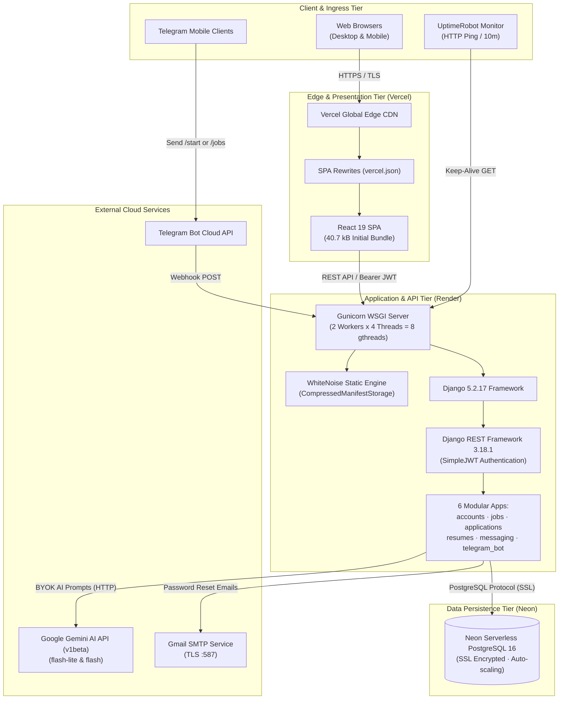
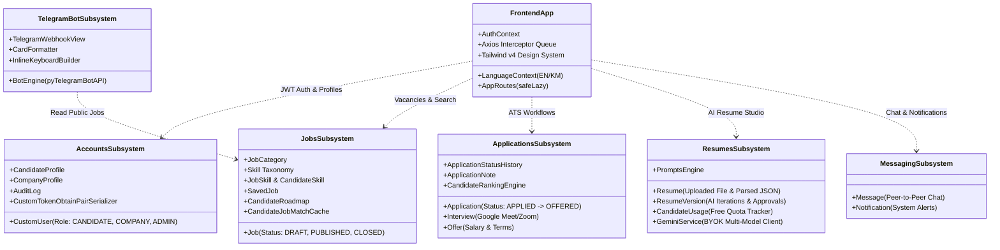
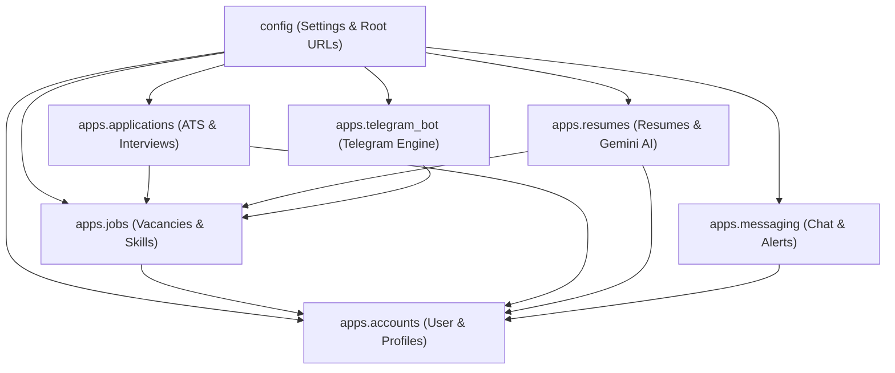

# CareerLens — System Architecture & Technical Design

> **Document Type:** System Architecture Specification  
> **Target Audience:** Lead Architects, Backend & Frontend Engineers, DevOps Specialists  
> **Status:** Verified from Codebase Implementation  
> **Interactive Visualization:** Available at [architecture.html](file:///d:/Project/University/Website/CareerLens/.archify/architecture-careerlens-20261111-153500/architecture.html)  
> **Last Updated:** 2026-11-11  

---

## 1. Architectural Style & Paradigms

CareerLens is architected as a **decoupled, multi-tier Single-Page Application (SPA) and RESTful API** leveraging cloud-native deployment patterns. 



### Core Design Patterns Applied

1. **Modular Monolithic Backend (Django Apps):**
   - The backend avoids microservice complexity by structuring domains into decoupled, cohesive Django apps: `accounts`, `jobs`, `applications`, `resumes`, `messaging`, and `telegram_bot`.
   - Each app encapsulates its own ORM models, serializers, viewsets, URL routers, permission classes, and test suites.
   - Cross-domain interactions occur strictly through explicit foreign keys, Python module imports, or shared services (e.g. `log_audit_action`, `filter_jobs`).

2. **Frontend Service-Repository Pattern:**
   - The React frontend encapsulates all network operations within dedicated service modules (`frontend/src/services/`): `authService.js`, `jobService.js`, `applicationService.js`, `candidateService.js`, `resumeService.js`, `adminService.js`.
   - UI components never make direct Axios or fetch calls; they consume typed service promises, isolating network concerns and response normalization from rendering logic.

3. **Silent Token Refresh with Request Queueing:**
   - Stateless JWT tokens expire automatically. Rather than forcing re-authentication on access token expiration, an Axios response interceptor intercepts HTTP 401 errors.
   - A concurrency guard (`isRefreshing`) suspends concurrent requests in a promise queue (`failedQueue`), issues a single refresh request to `/api/auth/login/refresh/`, updates the access token in memory/storage, and seamlessly replays the pending requests.

4. **Self-Healing Dynamic Route Splitting (`safeLazy`):**
   - Traditional SPA code splitting fails when a new frontend release replaces chunk hashes, causing errors for active users.
   - CareerLens wraps `React.lazy` with a proprietary `safeLazy` higher-order function in [AppRoutes.jsx](file:///d:/Project/University/Website/CareerLens/frontend/src/routes/AppRoutes.jsx). When a chunk import fails due to version mismatch, it performs an automatic session-bounded page refresh, restoring seamless continuity.

5. **Bring-Your-Own-Key (BYOK) Multi-Model AI Pattern:**
   - To avoid centralized AI infrastructure costs, CareerLens employs a client-empowered BYOK model for Google Gemini AI.
   - Keys are validated server-side against Google's API before storage and executed across an automatic model fallback ladder: `gemini-3.5-flash-lite` $\to$ `gemini-3.8-flash` $\to$ `gemini-3.1-flash-lite` $\to$ `gemini-2.5-flash-lite`.

---

## 2. Major Components & Subsystem Boundaries



### Component Details & Responsibilities

| Subsystem | Boundary & Hosting | Responsibilities | Key Technologies |
| :--- | :--- | :--- | :--- |
| **Edge Presentation** | Vercel Global Edge CDN | • Serves minified JS, CSS, and media bundles.<br>• Enforces client-side SPA route rewrites via `vercel.json`.<br>• Initial page load chunk size optimized to 40.7 kB. | Vercel CDN, HTTP/2, Brotli compression |
| **Frontend SPA Client** | User Browser Environment | • Client-side UI rendering with React 19.<br>• Route guards enforcing candidate, company, and admin authorization.<br>• Bi-directional theme and language switching (English/Khmer). | React 19, Tailwind v4, Vite 8, Lucide React, Recharts |
| **API Application Server** | Render Linux Container | • Gunicorn WSGI runtime executing 2 workers x 4 threads (8 concurrent requests).<br>• WhiteNoise static asset serving for Django Admin & DRF browseable API.<br>• Rate limiting, CORS, CSRF, and security headers. | Python 3.12, Django 5.2, Gunicorn 23, WhiteNoise 6.9 |
| **Relational Database** | Neon Serverless PostgreSQL | • ACID-compliant transactional persistence.<br>• 23 application models with foreign key cascades and uniqueness constraints.<br>• SSL encryption enforced (`sslmode=require`) with connection pooling. | PostgreSQL 16, pgBouncer connection pool |
| **AI Integration Gateway**| Google Cloud Generative Language | • Multi-model resume parsing, ATS scoring, diagnosis, and resume generation.<br>• JSON-mode structured output schema enforcement. | Gemini API v1beta, HTTPS REST |
| **Telegram Mobile Gateway**| Telegram Cloud API | • Webhook push notifications from Telegram users.<br>• Inline keyboards and deep links into web application views. | pyTelegramBotAPI, Telegram Webhook |
| **Keep-Alive Monitor** | UptimeRobot Cloud | • Periodic HTTP GET ping to `/api/telegram/webhook/` every 10 minutes.<br>• Bypasses Render's 15-minute inactivity spin-down, preventing 50s cold starts. | Automated HTTP Probe |

---

## 3. Communication Protocols & Interfaces

### 1. Client-to-API Communication (HTTPS REST)
- **Protocol:** HTTP/1.1 and HTTP/2 over TLS 1.3.
- **Authentication Scheme:** `Authorization: Bearer <access_token>`.
- **Payload Format:** `application/json` for standard endpoints; `multipart/form-data` for resume file uploads.
- **Error Format:** Standardized DRF JSON responses:
  ```json
  { "detail": "Human readable error message" }
  ```
  or field-level validation errors:
  ```json
  { "email": ["This field must be unique."] }
  ```

### 2. Telegram Bot Webhook Communication
- **Protocol:** HTTPS POST push from Telegram Cloud servers.
- **Security Validation:** `X-Telegram-Bot-Api-Secret-Token` header verified against `TELEGRAM_WEBHOOK_SECRET` environment variable in [views.py](file:///d:/Project/University/Website/CareerLens/backend/apps/telegram_bot/views.py).
- **Processing:** Asynchronous payload parsing into `telebot.types.Update`, followed by routing to command handlers (`/start`, `/jobs`, `/search`, `/remote`, `/help`) and inline callback queries (`job_{id}`).

### 3. Keep-Alive Probe Interface
- **Protocol:** HTTP GET targeting `/api/telegram/webhook/`.
- **Response:** HTTP 200 JSON payload reporting bot readiness:
  ```json
  {
    "service": "CareerLens Telegram Bot Webhook",
    "status": "ready",
    "bot_configured": true,
    "secret_configured": true
  }
  ```
- **Operational Impact:** Consumes zero database overhead while resetting Render's container inactivity countdown timer.

---

## 4. Internal Dependency Architecture

The backend dependency graph exhibits clean, acyclic layer separation:



### Dependency Rules Verified in Code:
1. `accounts` has **no downstream app dependencies**; it is the foundational identity provider.
2. `jobs` depends solely on `accounts` for `CompanyProfile` and `CandidateProfile` references.
3. `applications` references `accounts` (actors, candidates) and `jobs` (vacancies).
4. `resumes` references `accounts` (candidate profiles) and `jobs` (skills/target vacancies).
5. `telegram_bot` reads directly from `jobs.services` (`get_public_jobs`, `get_public_job_by_id`) with zero dependency on frontend or authentication tiers.
6. **No circular imports exist** across any modules (validated via AST structural analysis).

---

## 5. Security & Governance Architecture

1. **Password Hashing:** Django PBKDF2 with SHA-256 (default iterations $\ge$ 720,000).
2. **Stateless JWT Authorization:** Access tokens are signed using the backend's secret key with HMAC-SHA256. User ID and role claims are verified on every incoming request without requiring database hits for token resolution.
3. **Role-Based Permissions (RBAC):** Custom DRF permission classes enforce role boundaries:
   - `IsCandidateUser`: Restricts access to student features.
   - `IsCompanyUser`: Restricts job posting and applicant review to employers.
   - `IsAdminUserRole`: Restricts platform auditing and user management to administrators.
   - `IsOwnerOrReadOnly`: Ensures candidates and companies can only mutate their own records.
4. **CORS & CSRF Isolation:** CORS is configured to strictly permit trusted frontend domains (`CORS_ALLOWED_ORIGINS`). CSRF trusted origins are registered for secure Django admin form submissions over HTTPS.
5. **Cookie Hardening in Production:** When `DEBUG=False`, `SESSION_COOKIE_SECURE`, `CSRF_COOKIE_SECURE`, `SECURE_BROWSER_XSS_FILTER`, and `SECURE_CONTENT_TYPE_NOSNIFF` are strictly enabled.

---

## 6. Significant Technical Decisions (ADR Summary)

| ID | Decision Title | Context & Alternatives Considered | Justification & Outcome |
| :--- | :--- | :--- | :--- |
| **ADR-01** | **Neon Serverless PostgreSQL with SSL** | SQLite (dev-only) vs. Render Postgres ($7/mo) vs. Neon Serverless (Free). | Neon provides native PostgreSQL 16 over SSL with auto-scaling and connection pooling, completely eliminating local vs. production SQL dialect mismatches. |
| **ADR-02** | **Bring-Your-Own-Key (BYOK) Gemini AI** | Centralized API key with billing vs. Paid platform subscription vs. BYOK. | Students supply their own free Google Gemini API key. Removes platform hosting operating expenses while granting candidates unlimited AI CV iterations. |
| **ADR-03** | **UptimeRobot Keep-Alive Integration** | Render paid web tier ($7/mo) vs. Accept 50s cold starts vs. Keep-alive ping. | Pinging the lightweight Telegram webhook GET endpoint every 10 minutes keeps the Gunicorn web service warm 24/7 without exceeding free tier hours. |
| **ADR-04** | **`safeLazy` Frontend Chunk Recovery** | Traditional `React.lazy` vs. Service Worker caching vs. `safeLazy` retry. | Prevents broken user experiences following production redeployments by catching dynamic import failures and initiating a one-time session-guarded reload. |
| **ADR-05** | **Stateless JWT Dual-Token Lifecycle** | Server-side Django sessions vs. Stateful database tokens vs. SimpleJWT. | SimpleJWT enables stateless horizontal scaling. 7-day access lifetime paired with 30-day refresh token balance developer ergonomics with security. |

