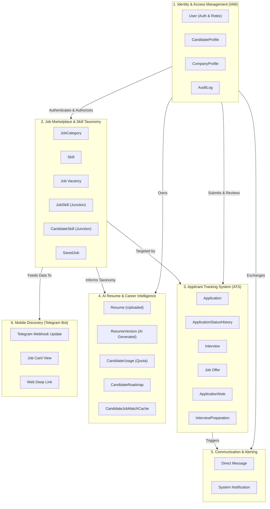
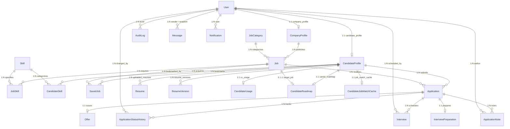
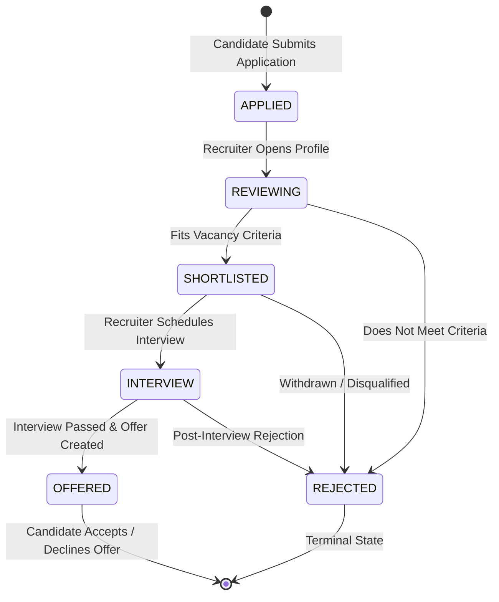

# CareerLens — Domain & Conceptual Model

> **Document Type:** Domain Modeling & Entity-Relationship Specification  
> **Target Audience:** Software Architects, Data Engineers, Full-Stack Developers  
> **Status:** Fully Verified Against Django ORM Models and Database Migrations  
> **Last Updated:** 2026-11-11  

---

## 1. Domain Overview & Bounded Contexts

CareerLens operates across **six primary Bounded Contexts**, each modeling a cohesive domain with distinct boundaries, entities, and business rules:

---

## 2. Comprehensive Entity-Relationship Diagram (ERD)

The CareerLens schema consists of **23 verified models** implemented across 5 database-backed Django apps:

---

## 3. Detailed Entity Catalog & Specifications

### 1. Identity & Access Management (IAM)

#### `User` (`accounts.User`)
- **Table Name:** `accounts_user`
- **Inheritance:** Extends Django's `AbstractUser`.
- **Primary Responsibilities:** Core authentication identity, credential storage, role assignment, and avatar reference.
- **Attributes:**
  - `id` (BigAutoField, PK)
  - `username` (CharField, unique, max_length=150)
  - `email` (EmailField, unique, indexed)
  - `password` (CharField, hashed with PBKDF2-SHA256)
  - `role` (CharField, choices=`CANDIDATE`, `COMPANY`, `ADMIN`, default=`CANDIDATE`)
  - `avatar` (TextField, optional image URL or Base64 string)
  - `is_active` (BooleanField, default=True)
  - `date_joined` (DateTimeField, auto_now_add=True)
- **Business Rules:**
  - Email addresses must be strictly unique across the platform.
  - The `role` determines which profile table (`CandidateProfile` or `CompanyProfile`) is linked.

#### `CandidateProfile` (`accounts.CandidateProfile`)
- **Table Name:** `accounts_candidateprofile`
- **Primary Responsibilities:** Stores student education, major, graduation expectations, bio, and personalized Gemini API key.
- **Attributes:**
  - `id` (BigAutoField, PK)
  - `user` (OneToOneField to `User`, on_delete=CASCADE, related_name="candidate_profile")
  - `university` (CharField, max_length=255, blank=True)
  - `major` (CharField, max_length=255, blank=True)
  - `graduation_year` (PositiveIntegerField, nullable)
  - `bio` (TextField, blank=True)
  - `resume_file` (FileField, upload_to="resumes/", nullable)
  - `gemini_api_key` (CharField, max_length=255, blank=True, stores encrypted/hashed candidate API key)
  - `avatar` (TextField, blank=True)
- **Constraints:** Exactly one candidate profile per candidate user.

#### `CompanyProfile` (`accounts.CompanyProfile`)
- **Table Name:** `accounts_companyprofile`
- **Primary Responsibilities:** Stores employer business data, industry, size, website, branding logo, and verification status.
- **Attributes:**
  - `id` (BigAutoField, PK)
  - `user` (OneToOneField to `User`, on_delete=CASCADE, related_name="company_profile")
  - `company_name` (CharField, max_length=255)
  - `industry` (CharField, max_length=255, blank=True)
  - `size` (CharField, max_length=100, blank=True, e.g. "10-50 employees")
  - `location` (CharField, max_length=255, blank=True)
  - `website` (URLField, blank=True)
  - `logo` (TextField, blank=True)
  - `verification_status` (CharField, choices=`PENDING`, `VERIFIED`, `REJECTED`, default=`PENDING`)
- **Business Rules:**
  - Employers cannot post verified job listings until approved by an administrator (`VERIFIED`).

#### `AuditLog` (`accounts.AuditLog`)
- **Table Name:** `accounts_auditlog`
- **Primary Responsibilities:** Immutable append-only audit trail capturing security-sensitive actions.
- **Attributes:**
  - `id` (BigAutoField, PK)
  - `actor` (ForeignKey to `User`, on_delete=SET_NULL, null=True, related_name="audit_logs")
  - `action` (CharField, max_length=255, e.g. "CREATE", "UPDATE", "DELETE", "VERIFY")
  - `target_type` (CharField, max_length=255, e.g. "Job", "User", "Application")
  - `target_id` (CharField, max_length=255)
  - `details` (TextField, descriptive log entry)
  - `created_at` (DateTimeField, auto_now_add=True)
- **Constraints:** Append-only; no update or deletion views exist.

---

### 2. Job Marketplace & Taxonomy

#### `JobCategory` (`jobs.JobCategory`)
- **Table Name:** `jobs_jobcategory`
- **Primary Responsibilities:** Standardized grouping of job openings (e.g. "Software Engineering", "Data Science", "Design").
- **Attributes:** `id`, `name` (unique, max_length=150), `created_at`.

#### `Skill` (`jobs.Skill`)
- **Table Name:** `jobs_skill`
- **Primary Responsibilities:** Canonical taxonomy of technical and soft skills (e.g. "Python", "React", "PostgreSQL", "Docker").
- **Attributes:** `id`, `name` (unique, max_length=255).

#### `Job` (`jobs.Job`)
- **Table Name:** `jobs_job`
- **Primary Responsibilities:** Represents a vacancy published by an employer.
- **Attributes:**
  - `id` (BigAutoField, PK)
  - `company` (ForeignKey to `CompanyProfile`, on_delete=CASCADE, related_name="jobs")
  - `title` (CharField, max_length=255)
  - `description` (TextField)
  - `location` (CharField, max_length=255, blank=True)
  - `employment_type` (CharField, choices=`FULL_TIME`, `PART_TIME`, `CONTRACT`, `INTERNSHIP`, default=`FULL_TIME`)
  - `workplace_type` (CharField, choices=`ON_SITE`, `HYBRID`, `REMOTE`, default=`ON_SITE`)
  - `salary_min` & `salary_max` (DecimalField, max_digits=10, decimal_places=2, nullable)
  - `status` (CharField, choices=`DRAFT`, `PUBLISHED`, `CLOSED`, default=`DRAFT`)
  - `deadline` (DateTimeField, nullable)
  - `created_at` & `updated_at` (DateTimeField)
- **Business Rules:**
  - Unauthenticated visitors and candidates can only inspect jobs in `PUBLISHED` status.
  - Only the owning company or administrators can modify job details.

#### `JobSkill` (`jobs.JobSkill`)
- **Table Name:** `jobs_jobskill`
- **Primary Responsibilities:** Junction table binding required skills to job vacancies.
- **Attributes:** `id`, `job` (FK to `Job`), `skill` (FK to `Skill`).
- **Constraints:** `unique_together = ('job', 'skill')`.

#### `CandidateSkill` (`accounts.CandidateSkill`)
- **Table Name:** `accounts_candidateskill`
- **Primary Responsibilities:** Junction table capturing candidate proficiencies.
- **Attributes:**
  - `id` (BigAutoField, PK)
  - `candidate` (ForeignKey to `CandidateProfile`, on_delete=CASCADE, related_name="skills")
  - `skill` (ForeignKey to `Skill`, on_delete=CASCADE, related_name="candidate_skills")
  - `proficiency` (CharField, choices=`BEGINNER`, `INTERMEDIATE`, `EXPERT`, default=`INTERMEDIATE`)
- **Constraints:** `unique_together = ('candidate', 'skill')`.

#### `SavedJob` (`jobs.SavedJob`)
- **Table Name:** `jobs_savedjob`
- **Primary Responsibilities:** Bookmarks for candidates to save vacancies for later application.
- **Attributes:** `id`, `candidate` (FK to `CandidateProfile`), `job` (FK to `Job`), `created_at`.
- **Constraints:** `unique_together = ('candidate', 'job')`.

---

### 3. Applicant Tracking System (ATS)

#### `Application` (`applications.Application`)
- **Table Name:** `applications_application`
- **Primary Responsibilities:** Core transaction connecting a candidate to an employer's vacancy.
- **Attributes:**
  - `id` (BigAutoField, PK)
  - `candidate` (ForeignKey to `CandidateProfile`, on_delete=CASCADE, related_name="applications")
  - `job` (ForeignKey to `Job`, on_delete=CASCADE, related_name="applications")
  - `status` (CharField, choices=`APPLIED`, `REVIEWING`, `SHORTLISTED`, `INTERVIEW`, `OFFERED`, `REJECTED`, default=`APPLIED`)
  - `resume_file` (FileField, upload_to='resumes/applications/', nullable)
  - `cover_letter` (TextField, blank=True)
  - `applied_at` & `updated_at` (DateTimeField)
- **Constraints:**
  - `unique_together = ('candidate', 'job')`: Candidates are strictly forbidden from submitting duplicate applications to the same job vacancy.

#### `ApplicationStatusHistory` (`applications.ApplicationStatusHistory`)
- **Table Name:** `applications_applicationstatushistory`
- **Primary Responsibilities:** Immutable audit log tracking every ATS status change for an application.
- **Attributes:**
  - `id` (BigAutoField, PK)
  - `application` (ForeignKey to `Application`, on_delete=CASCADE, related_name="status_history")
  - `changed_by` (ForeignKey to `User`, on_delete=SET_NULL, null=True, related_name="status_changes")
  - `old_status` (CharField, max_length=20, choices=`Application.Status.choices`, blank=True)
  - `new_status` (CharField, max_length=20, choices=`Application.Status.choices`)
  - `note` (TextField, blank=True)
  - `created_at` (DateTimeField, auto_now_add=True)

#### `Interview` (`applications.Interview`)
- **Table Name:** `applications_interview`
- **Primary Responsibilities:** Scheduled evaluation meetings between recruiters and candidates.
- **Attributes:**
  - `id` (BigAutoField, PK)
  - `application` (ForeignKey to `Application`, on_delete=CASCADE, related_name="interviews")
  - `scheduled_by` (ForeignKey to `User`, on_delete=SET_NULL, null=True, related_name="scheduled_interviews")
  - `scheduled_at` (DateTimeField)
  - `meeting_link` (URLField, blank=True, stores Google Meet or Zoom link)
  - `location` (CharField, max_length=255, blank=True)
  - `status` (CharField, choices=`SCHEDULED`, `COMPLETED`, `CANCELED`, default=`SCHEDULED`)
  - `feedback` (TextField, blank=True)

#### `Offer` (`applications.Offer`)
- **Table Name:** `applications_offer`
- **Primary Responsibilities:** Formal employment offer extended to a candidate.
- **Attributes:**
  - `id` (BigAutoField, PK)
  - `application` (OneToOneField to `Application`, on_delete=CASCADE, related_name="offer")
  - `salary` (DecimalField, max_digits=10, decimal_places=2)
  - `currency` (CharField, max_length=10, default="USD")
  - `message` (TextField, blank=True)
  - `status` (CharField, choices=`PENDING`, `ACCEPTED`, `DECLINED`, default=`PENDING`)
  - `sent_at` (DateTimeField, auto_now_add=True)
  - `responded_at` (DateTimeField, nullable)

#### `ApplicationNote` (`applications.ApplicationNote`)
- **Table Name:** `applications_applicationnote`
- **Primary Responsibilities:** Private internal notes visible only to the hiring company's recruiters.
- **Attributes:**
  - `id` (BigAutoField, PK)
  - `application` (ForeignKey to `Application`, on_delete=CASCADE, related_name="notes")
  - `author` (ForeignKey to `User`, on_delete=CASCADE, related_name="application_notes")
  - `note` (TextField)
  - `created_at` & `updated_at` (DateTimeField)

#### `InterviewPreparation` (`applications.InterviewPreparation`)
- **Table Name:** `applications_interviewpreparation`
- **Primary Responsibilities:** AI-generated tailored interview preparation kit customized to the specific candidate and job vacancy.
- **Attributes:**
  - `id` (BigAutoField, PK)
  - `application` (OneToOneField to `Application`, on_delete=CASCADE, related_name="interview_prep")
  - `prep_data` (JSONField, default=dict, containing technical questions, behavioral tips, and company research)
  - `is_ai_generated` (BooleanField, default=True)
  - `created_at` & `updated_at` (DateTimeField)

---

### 4. AI Resume & Career Intelligence

#### `Resume` (`resumes.Resume`)
- **Table Name:** `resumes_resume`
- **Primary Responsibilities:** Stores raw uploaded candidate resume documents, parsed contact details, and multi-dimensional analysis scores.
- **Attributes:**
  - `id` (BigAutoField, PK)
  - `candidate` (ForeignKey to `CandidateProfile`, on_delete=CASCADE, related_name='uploaded_resumes')
  - `file` (FileField, upload_to='resumes/uploads/', nullable)
  - `file_name` (CharField, max_length=255, blank=True)
  - `target_role` (CharField, max_length=255, blank=True)
  - `parsed_data` (JSONField, default=dict)
  - `analysis` (JSONField, default=dict, stores radar scores, ATS score, strengths, and weaknesses)
  - `is_active` (BooleanField, default=True)

#### `ResumeVersion` (`resumes.ResumeVersion`)
- **Table Name:** `resumes_resumeversion`
- **Primary Responsibilities:** Multi-version CV studio entity storing generated improvements (v1, v2, etc.) with structured sections.
- **Attributes:**
  - `id` (BigAutoField, PK)
  - `candidate` (ForeignKey to `CandidateProfile`, on_delete=CASCADE, related_name='resume_versions')
  - `version_number` (PositiveIntegerField, default=1)
  - `title` (CharField, max_length=255, default='Draft CV')
  - `template` (CharField, max_length=50, default='modern')
  - `content` (JSONField, default=dict, containing contact, summary, experience, education, skills)
  - `is_current` (BooleanField, default=False)
  - `is_approved` (BooleanField, default=False)
  - `reanalysis_data` (JSONField, default=dict)

#### `CandidateUsage` (`resumes.CandidateUsage`)
- **Table Name:** `resumes_candidateusage`
- **Primary Responsibilities:** Enforces freemium quota limits on AI-driven CV improvements.
- **Attributes:**
  - `id` (BigAutoField, PK)
  - `candidate` (OneToOneField to `CandidateProfile`, on_delete=CASCADE, related_name='cv_usage')
  - `plan_tier` (CharField, max_length=20, default='FREE')
  - `improvements_used` (PositiveIntegerField, default=0)
  - `improvements_limit` (PositiveIntegerField, default=5)
- **Business Rules:**
  - Free tier candidates are limited to 5 AI improvements before requiring a plan tier upgrade or manual reset.

#### `CandidateRoadmap` (`jobs.CandidateRoadmap`)
- **Table Name:** `jobs_candidateroadmap`
- **Primary Responsibilities:** Personalized multi-stage career progression roadmap synthesized by Google Gemini AI.
- **Attributes:**
  - `id` (BigAutoField, PK)
  - `candidate` (OneToOneField to `CandidateProfile`, on_delete=CASCADE, related_name="career_roadmap")
  - `target_role` (CharField, max_length=255)
  - `target_job` (ForeignKey to `Job`, on_delete=SET_NULL, null=True, blank=True)
  - `weekly_hours` (PositiveIntegerField, default=10)
  - `roadmap_data` (JSONField, default=dict, containing phases, milestones, required skills, and completion flags)

#### `CandidateJobMatchCache` (`jobs.CandidateJobMatchCache`)
- **Table Name:** `jobs_candidatejobmatchcache`
- **Primary Responsibilities:** Precomputed match scores between a candidate's verified skills and published vacancies.
- **Attributes:**
  - `id` (BigAutoField, PK)
  - `candidate` (OneToOneField to `CandidateProfile`, on_delete=CASCADE, related_name="job_match_cache")
  - `results` (JSONField, default=list, cached ranked job lists with calculated percentage scores)
  - `top_score` (IntegerField, default=0)
  - `target_role`, `preferred_location`, `preferred_employment_type`, `preferred_workplace_type` (CharFields)

---

### 5. Communication & Alerting

#### `Message` (`messaging.Message`)
- **Table Name:** `messaging_message`
- **Primary Responsibilities:** Peer-to-peer direct communication between candidates and recruiters.
- **Attributes:**
  - `id` (BigAutoField, PK)
  - `sender` (ForeignKey to `User`, on_delete=CASCADE, related_name="sent_messages")
  - `recipient` (ForeignKey to `User`, on_delete=CASCADE, related_name="received_messages")
  - `text` (TextField)
  - `sent_at` (DateTimeField, auto_now_add=True)
  - `read_at` (DateTimeField, nullable)

#### `Notification` (`messaging.Notification`)
- **Table Name:** `messaging_notification`
- **Primary Responsibilities:** User-specific system notifications triggered by ATS events.
- **Attributes:**
  - `id` (BigAutoField, PK)
  - `user` (ForeignKey to `User`, on_delete=CASCADE, related_name="notifications")
  - `message` (TextField)
  - `type` (CharField, choices=`INFO`, `ALERT`, `SUCCESS`, default=`INFO`)
  - `is_read` (BooleanField, default=False)
  - `created_at` (DateTimeField, auto_now_add=True)

---

## 4. Fundamental Business Rules & Invariants

1. **Application Uniqueness Invariant:**
   A student candidate can submit exactly one application to a given job vacancy (`unique_together = ('candidate', 'job')`). Retrying application submission raises HTTP 400 validation error.
2. **Deterministic ATS State Transitions:**
   Whenever an application transitions between statuses, an atomic transaction:
   - Updates `Application.status`.
   - Records an immutable `ApplicationStatusHistory` row naming the actor and delta.
   - Dispatches a targeted `Notification` to the candidate.
   - Logs an administrative `AuditLog` entry.
3. **Role Exclusivity:**
   A user account cannot be both a `CANDIDATE` and a `COMPANY`. Profiles are mutually exclusive one-to-one extensions of `accounts.User`.
4. **Freemium AI Quota Invariant:**
   Free plan candidates are constrained to 5 improvements in `CandidateUsage`. Any subsequent generation request is rejected unless upgraded or approved.
5. **BYOK Security:**
   Candidates supply their own Google Gemini API key. Before persisting, the key is actively verified against Google's `ListModels` API endpoint.

