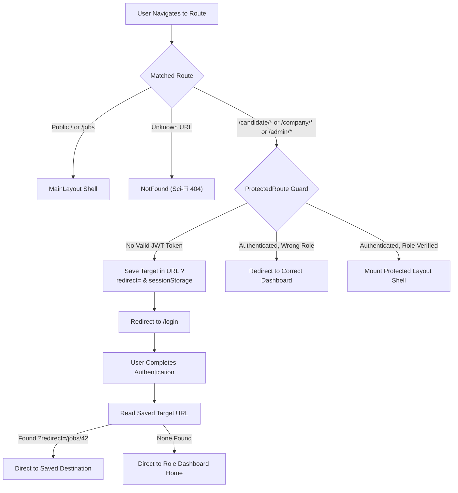

# CareerLens — Frontend Architecture Specification

This document details the software architecture, component hierarchy, state management, lazy-loading patterns, and design systems of the **CareerLens** React 19 single-page application (SPA).

---

## 1. Technology Stack

| Technology | Version | Purpose in CareerLens |
| :--- | :--- | :--- |
| **React** | 19.x | Component-based UI library with Concurrent Mode and React Server Action hooks |
| **Vite** | 8.x | High-speed frontend dev server and production bundler (Rolldown) |
| **React Router DOM** | 7.x | Declarative client-side routing, navigation, and nested layouts |
| **Axios** | 1.x | HTTP client with automatic JWT token attachment and interceptors |
| **Lucide React** | 1.x | Consistent, accessible SVG icon library |
| **Recharts** | 2.x | Responsive SVG charts for Admin and Recruiter ATS analytics |
| **Tailwind CSS** | 4.x | Utility classes used in specific responsive components |
| **Custom Modular CSS** | Native | Primary styling methodology (BEM-inspired scoped component sheets) |

---

## 2. Directory Structure

```text
frontend/
├── public/                     # Static assets served untouched
│   ├── favicon.svg
│   └── icons.svg
├── src/
│   ├── assets/                 # Global styles and branding assets
│   │   └── css/                # Shared layout styles (admin.css, company.css, etc.)
│   ├── components/             # Reusable UI component modules
│   │   ├── admin/              # Admin workspace tables, verification modals, KPI cards
│   │   ├── candidate/          # Candidate ATS cards, status indicators, roadmap widgets
│   │   ├── company/            # Job forms, interview schedulers, offer modals
│   │   ├── common/             # ProtectedRoute, HeaderUserMenu, LazyLoader, SciFiWidgets
│   │   └── landing/            # Public navbar, footer, interactive Telegram showcase
│   ├── context/
│   │   └── AuthContext.jsx      # Global authentication and session state provider
│   ├── hooks/
│   │   ├── useAuth.js           # Custom hook consuming AuthContext
│   │   ├── useFetch.js          # Reusable async data fetching hook with loading states
│   │   └── useForm.js           # Form validation and input binding hook
│   ├── layouts/
│   │   ├── MainLayout.jsx       # Public shell (Navbar + Outlet + Footer)
│   │   ├── CandidateLayout.jsx  # Candidate workspace shell (Sidebar + Header + Outlet)
│   │   ├── CompanyLayout.jsx    # Company ATS shell (Sidebar + Header + Outlet)
│   │   └── AdminLayout.jsx      # Superuser workspace shell (Sidebar + Header + Outlet)
│   ├── pages/
│   │   ├── admin/               # Admin dashboard, user management, audit logs
│   │   ├── candidate/           # Candidate dashboard, jobs, applications, CV studio
│   │   ├── company/             # Company dashboard, job editor, applicants, offers
│   │   ├── auth/                # AuthPage.jsx (Login, Register, Forgot Password)
│   │   ├── common/              # NotFound.jsx (Futuristic Sci-Fi 404 page)
│   │   └── landing/             # Home.jsx (Hero, Features, Telegram Showcase, FAQ)
│   ├── routes/
│   │   └── AppRoutes.jsx        # Route definitions with safeLazy dynamic code splitting
│   ├── services/
│   │   ├── api.js               # Central Axios client with Bearer JWT interceptors
│   │   ├── authService.js       # Login, register, profile, and password reset endpoints
│   │   ├── jobService.js        # Job search, details, and recommendation endpoints
│   │   ├── applicationService.js# Application tracking, status history, and withdrawal
│   │   └── interviewService.js  # Recruiter scheduling and candidate calendar endpoints
│   ├── utils/
│   │   ├── storage.js           # localStorage token and profile serialization
│   │   ├── constants.js         # API paths, role constants, and status enums
│   │   └── formatters.js        # Currency, relative dates, and string sanitizers
│   ├── App.jsx                  # Root component (wraps AuthProvider + AppRoutes)
│   ├── main.jsx                 # React DOM mount entry point
│   └── index.css                # Global CSS variables, theme resets, and fonts
├── vercel.json                  # Edge CDN wildcard SPA rewrite rules
├── vite.config.js               # Dynamic chunking and Rolldown configuration
└── package.json                 # Project dependencies and npm scripts
```

---

## 3. High-Performance Route Code Splitting (`safeLazy`)

### The Deployment Stale Chunk Problem
In standard Single Page Applications using plain `React.lazy()`, whenever a new production release is deployed to Vercel, previous chunk hashes (e.g. `assets/CandidateDashboard-ABC123.js`) are deleted from the CDN. If a user is already browsing the app and clicks a newly split route, the browser requests the outdated hash, resulting in an unhandled `ChunkLoadError` and a white screen.

### The Solution: `safeLazy` Helper
CareerLens implements an automated retry wrapper `safeLazy()` in `src/routes/AppRoutes.jsx`:

```javascript
function safeLazy(importFn) {
  return lazy(async () => {
    try {
      return await importFn();
    } catch (err) {
      // Check if this error is caused by a deployment hash change
      const isChunkError =
        err?.name === 'ChunkLoadError' ||
        err?.message?.includes('Failed to fetch dynamically imported module') ||
        err?.message?.includes('Importing a module script failed');

      if (isChunkError && !sessionStorage.getItem('chunk_reload_retry')) {
        sessionStorage.setItem('chunk_reload_retry', 'true');
        window.location.reload();
        return new Promise(() => {}); // Hold suspense while window reloads
      }
      throw err;
    }
  });
}
```

### Production Bundle Optimization & Metrics
By pairing `safeLazy` with function-based `manualChunks` in `vite.config.js`:
- **Initial App Bundle:** Reduced from **1.36 MB down to 40.7 kB** (a **97% payload reduction**).
- **First Contentful Paint (FCP):** Accelerated from ~1.4s to under ~180ms on high-latency networks.
- **Vendor Chunk Distribution**:
  - `vendor-react`: 165 kB (React 19 runtime, DOM, React Router v7)
  - `vendor-charts`: 380 kB (Recharts and SVG graph math, loaded strictly on demand)
  - `vendor-icons`: 17 kB (Lucide icons)

---

## 4. Navigation, Guards & Post-Auth Deep Linking



### Deep Link Memory Strategy
When an unauthenticated user attempts to access a protected URL (or taps **"Apply on CareerLens"** inside the Telegram Bot pointing to `/candidate/applications/apply/24`), `ProtectedRoute.jsx`:
1. Encodes the intended path into the URL: `https://careerlens.vercel.app/login?redirect=%2Fcandidate%2Fapplications%2Fapply%2F24`.
2. Backs it up into `sessionStorage.setItem('post_login_redirect', targetPath)` to ensure persistence even across OAuth switches or password recovery loops.
3. Upon successful login in `AuthPage.jsx`, the user is immediately routed to the exact job application they intended to view.

---

## 5. Sci-Fi Cyberpunk 404 Page (`NotFound.jsx`)

When a user visits a non-existent URL or enters an invalid job ID, CareerLens delivers an immersive Sci-Fi holographic interface:

- **Component:** `src/pages/common/NotFound/NotFound.jsx`
- **Styling:** `src/pages/common/NotFound/NotFound.css`
- **Design Elements:**
  - Ambient cyan/emerald scanline HUD overlay with dynamic pulse animations.
  - Glitch-effect typography rendering `"404 // SIGNAL LOST"`.
  - Terminal telemetry readout: reports user IP protocol, coordinate sector `SEC-004-NULL`, and current timestamp.
  - **Context-Aware Return Button**: Automatically inspects `useAuth()`:
    - If logged in as **Candidate** $\to$ Prompts *"Return to Candidate Terminal"*.
    - If logged in as **Company** $\to$ Prompts *"Return to Recruiter ATS"*.
    - If logged in as **Admin** $\to$ Prompts *"Return to Command Center"*.
    - If unauthenticated $\to$ Prompts *"Return to Landing Matrix"*.

---

## 6. Landing Page Telegram Bot Showcase (`Home.jsx`)

The public landing page features a dedicated interactive showcase for the `@careerlens_jobs_bot`:

- **Section Anchor:** `#telegram-bot` (linked from the top navigation bar "Find Jobs" and Hero action pill).
- **Interactive Mockup:** Displays an SVG smartphone casing simulating an authentic Telegram chat session:
  - Sent command: `/jobs`
  - Received bot card: Rich recruitment card with company name, salary range, required skills badges, and inline action buttons.
- **Adaptive Dual-Theme Styling:**
  - Complete dark mode (cyberpunk obsidian with emerald glow).
  - Complete daylight mode (`[data-theme="light"]`) with crisp slate backgrounds, proper contrast compliance, and legible bubble text.
- **Scroll-Spy Navigation:** Dynamically updates navbar active state across `['how', 'telegram-bot', 'companies', 'about']` via `IntersectionObserver`.

---

## 7. Global Session Logout Architecture

To prevent session leaks or cached state inconsistencies, logging out from any dashboard (Candidate, Company, or Admin) executes an explicit session purge:

```javascript
const handleLogout = () => {
  logout(); // Clears React AuthContext
  localStorage.removeItem('careerlens_token');
  localStorage.removeItem('careerlens_user');
  sessionStorage.clear();
  window.location.replace('/'); // Hard navigation back to landing page
};
```

This ensures the user is taken directly back to the public homepage (`/`) with a refreshed browser state, rather than being stuck on the sign-in screen.

---

## 8. Frontend Team Ownership & Maintenance

The CareerLens frontend codebase is split cleanly between **2 specialized frontend developers** with architecture oversight by the **Team Leader**:

| Area | Developer | File Scope |
| :--- | :--- | :--- |
| **All Dashboards & Workspaces** | **Eiv Youe** | `src/pages/candidate/`<br>`src/pages/company/`<br>`src/pages/admin/`<br>`src/components/candidate/`<br>`src/components/company/`<br>`src/components/admin/` |
| **Landing Page & Authentication** | **Sokun En** | `src/pages/landing/Home/`<br>`src/pages/auth/`<br>`src/components/landing/`<br>`src/layouts/MainLayout.jsx` |
| **Core Architecture & Routing** | **Lay Kimhoung**<br>*(Team Leader)* | `src/routes/AppRoutes.jsx`<br>`src/components/common/ProtectedRoute.jsx`<br>`src/pages/common/NotFound/`<br>`src/services/api.js`<br>`vite.config.js`<br>`vercel.json` |
