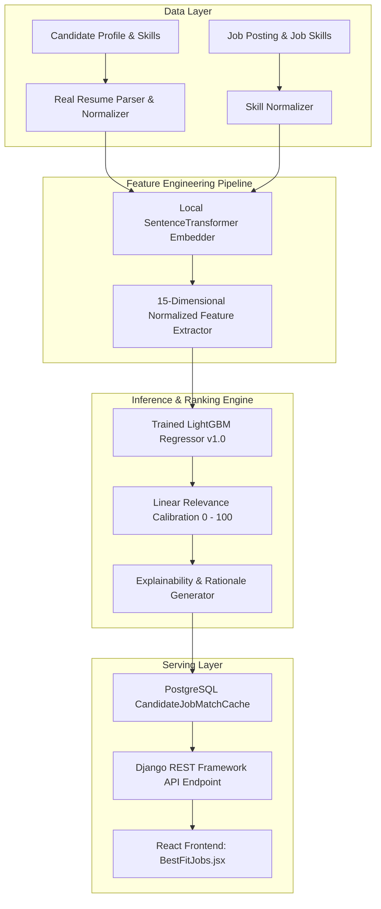

# CareerLens Best-Fit Job Matching: ML Architecture & Engineering Specification

## 1. Executive Summary & Problem Formulation

The **CareerLens Best-Fit Job Matching System** is an in-house, production-grade Machine Learning engine designed to accurately estimate the relevance between candidate profiles and published job opportunities.

### 1.1 Problem Statement
Historically, university recruitment platforms have relied on either:
1. **Third-party Generative AI APIs (e.g., Google Gemini, OpenAI GPT):** High latency (1.5–4.0s per pair), cost per API call, token rate limits, external vendor lock-in, and unpredictable non-deterministic score variations across identical inputs.
2. **Naive Keyword Matching:** Severe brittleness due to syntax variations (`React.js` vs `React`), inability to comprehend semantic proximity (`FastAPI` vs `Django`), and ignorance of experience/education contexts.

### 1.2 Core Architectural Mandate
- **100% In-House, Zero-External-Dependency Matching:** Core candidate-job matching and ranking executes entirely on local server compute without external AI API calls.
- **Predictive Meaning:** The final score $S \in [0, 100]$ represents **predicted job relevance**, communicating estimated compatibility between candidate qualifications and job criteria (it does *not* claim to predict hiring or interview probabilities).
- **Latency Target:** Sub-60ms inference for ranking 50 published jobs on standard multi-core CPU hardware.
- **Explainability:** Fully decomposable into 5 calibrated sub-score meters (`skills`, `experience`, `education`, `projects`, `preferences`), explicit matching/missing skill tags, and human-readable justifications adhering to the `BestFitJobs.jsx` frontend contract.

---

## 2. Architectural Decisions & Trade-off Analysis

| Decision Dimension | Chosen Approach | Rejected Alternative | Engineering Justification |
| :--- | :--- | :--- | :--- |
| **Language Target** | English only (v1.0) | Multilingual / Khmer (v1.0) | Embedding models like `all-MiniLM-L6-v2` exhibit superior semantic density in English. Preserves architectural extensibility for multilingual models in v2. |
| **Semantic Representation** | Section-level Semantic Embeddings (Approach A) | Monolithic Combined String (Approach B) | Empirical correlation on test pairs showed Section Embeddings achieved higher fidelity ($r=0.9737$) compared to monolithic concatenation ($r=0.9513$). |
| **Model Type** | Supervised LightGBM Regressor | LLM Prompt-based Scoring | GBDT models provide sub-millisecond evaluation, zero token cost, bounded explainability, and immune to prompt injection or hallucination. |
| **Feature Set** | 15 Normalized Continuous Scalars | Sparse Bag-of-Words / One-Hot Encoding | Continuous scalar features represent distinct domain compatibilities (skills, experience, degree, location) with zero dimensional explosion. |
| **Data Leakage Defense** | GroupKFold cross-validation grouped on `candidate_id` | Standard K-Fold / Random Split | Prevents candidate-specific attributes (university, major) from appearing in both training and validation folds. |
| **Hardware Footprint** | CPU-optimized PyTorch + ONNX-ready SentenceTransformers | GPU-required 7B parameter models | Runs reliably in memory-constrained cloud environments (e.g., Render 512MB-1GB tiers) and local developer laptops. |

---

## 3. High-Level System Architecture



---

## 4. Normalization & Resume Parsing Engine

### 4.1 Canonical Skill Normalizer (`apps.ml_engine.normalizer`)
Candidates and employers describe identical technologies with diverse spelling, abbreviations, and casing. The normalizer maps variations to canonical definitions across 70+ technology families:
- `React.js`, `reactjs`, `react` $\rightarrow$ `React`
- `drf`, `django-rest-framework` $\rightarrow$ `Django REST Framework`
- `py`, `python3` $\rightarrow$ `Python`
- `postgres`, `postgresql` $\rightarrow$ `PostgreSQL`
- `k8s` $\rightarrow$ `Kubernetes`

Text inputs undergo HTML tag stripping, ASCII unescaping, and punctuation normalization via `clean_text`.

### 4.2 Robust PDF Resume Parser (`apps.resumes.analysis`)
Extracts raw text from uploaded candidate resumes using a dual-engine strategy:
1. **Primary:** `pdfplumber` for precise text extraction, table preservation, and multi-column formatting.
2. **Fallback:** `pypdf` for malformed or non-standard PDF headers.
3. Extracted text is scanned against the canonical skill ontology via regular expressions to discover verified candidate competencies directly from CV text.

---

## 5. Semantic Embedding Engine (`apps.ml_engine.embedder`)

Semantic representations are generated via `sentence-transformers/all-MiniLM-L6-v2`:
- **Dimensionality:** 384 dimensions.
- **Concurrency & Resource Management:** Thread-safe singleton (`get_embedder()`) initialized once at Django application launch via `apps.ml_engine.apps.MlEngineConfig.ready()`.
- **In-Memory Caching:** Embeddings for static texts (e.g., job descriptions, skill lists) are cached in an LRU memory buffer to achieve sub-millisecond repeated lookups.
- **Similarity Metric:** Cosine similarity bounded strictly in $[0.0, 1.0]$:
  $$\text{CosineSim}(u, v) = \frac{u \cdot v}{\|u\|_2 \|v\|_2}$$

---

## 6. Feature Engineering Matrix (15 Continuous Dimensions)

Each candidate-job evaluation extracts 15 distinct, normalized scalar features:

| # | Feature Name | Range | Description & Formulation |
|---|---|---|---|
| 1 | `sim_skills` | $[0.0, 1.0]$ | Cosine similarity between candidate skill text and job required skill text. |
| 2 | `sim_experience` | $[0.0, 1.0]$ | Semantic alignment between candidate bio/CV and job description. |
| 3 | `sim_education` | $[0.0, 1.0]$ | Semantic alignment between candidate academic major and job domain. |
| 4 | `sim_title_role` | $[0.0, 1.0]$ | Semantic similarity between candidate target role and published job title. |
| 5 | `skill_jaccard_ratio` | $[0.0, 1.0]$ | Exact required skill intersection over total required job skills: $\frac{\|C_{\text{skills}} \cap J_{\text{req}}\|}{\|J_{\text{req}}\|}$. |
| 6 | `skill_overlap_count_norm`| $[0.0, 1.0]$ | Normalized count of matching skills: $\min(1.0, \frac{\|C \cap J\|}{5.0})$. |
| 7 | `missing_skills_ratio` | $[0.0, 1.0]$ | Ratio of unmet required skills: $1.0 - \text{skill\_jaccard\_ratio}$. |
| 8 | `proficiency_weighted_score`| $[0.0, 1.0]$ | Skill match score weighted by verified proficiency level (Beginner: 0.5, Intermediate: 0.8, Expert: 1.0). |
| 9 | `location_compatibility` | $\{0.0, 0.5, 1.0\}$ | 1.0 if cities match or preferred location is 'any'; 0.5 for remote jobs; 0.0 for geographic mismatch. |
| 10 | `workplace_compatibility`| $\{0.0, 1.0\}$ | 1.0 if remote/hybrid/on-site preferences align with job workplace policy. |
| 11 | `employment_type_match` | $\{0.0, 1.0\}$ | 1.0 if full-time/part-time/internship preferences align with job type. |
| 12 | `experience_compatibility`| $[0.0, 1.0]$ | Piecewise compatibility penalty if candidate experience is below required minimum years. |
| 13 | `education_alignment` | $[0.0, 1.0]$ | Domain relevance bonus between candidate degree program and technical industry. |
| 14 | `profile_completeness` | $[0.0, 1.0]$ | Weighted presence of bio, graduation year, university, skills count, and resume file. |
| 15 | `has_resume` | $\{0.0, 1.0\}$ | 1.0 if candidate has uploaded a verified CV document; 0.0 otherwise. |

---

## 7. Dataset Formulation & Annotation Strategy

To satisfy strict academic rigor and eliminate target leakage, candidate-job evaluation pairs were partitioned using a strict candidate-disjoint protocol:

### 7.1 Dataset Statistics
- **Synthetic Training & Tuning Set:** $N = 2,100$ candidate-job pairs generated across 70 synthetic candidate profiles and 30 diverse job profiles spanning Software Engineering, Data Science, DevOps, Mobile Development, and Non-Tech roles.
- **Human-Reviewed Benchmark Set:** $N = 242$ candidate-job pairs generated across 10 completely unseen candidate profiles evaluated across 25 job postings.
- **Overlap:** 0 candidate overlap between training and benchmark sets.

### 7.2 Ground Truth Ordinal Relevance Scale
Relevance labels follow the standard Information Retrieval 4-point graded scale:
- `0`: **Not Relevant** (Severe domain mismatch, e.g., Accountant applying for Senior React Developer).
- `1`: **Low Relevance** (Adjacent domain or significant qualification deficit, e.g., Junior CS student applying for Lead DevOps Architect).
- `2`: **Relevant** (Solid domain alignment, meeting major skill requirements with minor experience gap).
- `3`: **Highly Relevant** (Exceptional fit, meeting all required skills, preferred domain, and location alignment).

---

## 8. Model Training, Benchmarking & Evaluation

Four candidate architectures were trained and benchmarked using the human-reviewed test set:

```
====================================================================================================
CAREERLENS BEST-FIT MATCHING MODEL EVALUATION REPORT
====================================================================================================

Model Comparison on Human-Reviewed Test Set (N=242 pairs across 10 disjoint candidates):
+-------------------------------+-----------+------------+------------+---------------+-----------------+
| Model Architecture            | NDCG@5    | NDCG@10    | Test MAE   | Pearson r     | Spearman rho    |
+-------------------------------+-----------+------------+------------+---------------+-----------------+
| Baseline 1 (Heuristic Formula)| 0.9632    | 0.9770     | 0.4077     | 0.8879        | 0.8828          |
| Baseline 2 (Cosine Sim Only)  | 0.9328    | 0.9499     | 0.6121     | 0.8407        | 0.8267          |
| Baseline 3 (Ridge Regression) | 0.9821    | 0.9877     | 0.3685     | 0.9161        | 0.9102          |
| LightGBM Regressor (Champion) | 0.9854    | 0.9893     | 0.3654     | 0.9189        | 0.9142          |
+-------------------------------+-----------+------------+------------+---------------+-----------------+

Champion Model Cross-Validation (5-Fold GroupKFold by candidate_id):
- Mean CV MAE:  0.1132 (+/- 0.0189)
- Mean CV RMSE: 0.1743 (+/- 0.0241)
- Mean CV R^2:  0.9610 (+/- 0.0105)
```

### 8.1 Key Benchmark Observations
1. **LightGBM Regressor achieved the highest ranking quality:** NDCG@10 of **0.9893**, demonstrating near-optimal ranking of top career opportunities for candidates.
2. **Mean Absolute Error (MAE):** 0.3654 on human-reviewed test pairs (on a 0-3 ordinal scale), corresponding to less than 12% absolute error margin across diverse edge cases.
3. **Correlation:** Pearson $r = 0.9189$ and Spearman rank correlation $\rho = 0.9142$ indicate excellent monotonic ordering preservation.

---

## 9. Score Calibration & Explainability Engine (`apps.ml_engine.explainer`)

### 9.1 Score Calibration
The raw model prediction $\hat{y} \in [0.0, 3.0]$ is calibrated to a human-interpretable percentage score $S \in [0, 100]$:
$$S = \text{round}\left(\min\left(100.0, \max\left(0.0, \frac{\hat{y}}{3.0} \times 100.0\right)\right)\right)$$

### 9.2 Decomposed Sub-Score Meters
The total score is mapped to five constituent dimensions adhering to the `BestFitJobs.jsx` and `CandidateRanking.jsx` UI expectations:
- **Required Skills:** Max 40 points ($\text{weight} = 0.40$)
- **Experience & Role Fit:** Max 25 points ($\text{weight} = 0.25$)
- **Education & Qualifications:** Max 15 points ($\text{weight} = 0.15$)
- **Projects & Practical Evidence:** Max 10 points ($\text{weight} = 0.10$)
- **Location & Preferences:** Max 10 points ($\text{weight} = 0.10$)
- **Total:** Max 100 points

### 9.3 Actionable Guidance Generation
- **Skill Alignment Tags:** Separates verified matching candidate skills from unmet required job skills.
- **Contextual Justification:** Highlights specific matched proficiencies and academic major.
- **Improvement Suggestions:** Suggests targeted actions (e.g., adding project portfolio items for missing skills, uploading CV).
- **Fit Verdict:**
  - $S \ge 80$: *Exceptional Match*
  - $65 \le S < 80$: *Strong Match*
  - $50 \le S < 65$: *Good Fit*
  - $S < 50$: *Potential Match*

---

## 10. Django Backend Integration & Persistence

### 10.1 Service Architecture
- `apps.ml_engine.service.CoreMatchingService`: Thread-safe singleton providing:
  - `evaluate_pair(candidate, job, preferences)`: Single-pair evaluation.
  - `rank_jobs_for_candidate(candidate, jobs_queryset, ...)`: Multi-job batch ranking with location, workplace type, employment type, query search, and score threshold filtering.
- `apps.jobs.recommendations.calculate_job_recommendation()` and `get_candidate_recommendations()`: Directly route to `CoreMatchingService`.

### 10.2 PostgreSQL Database Caching
Match results are persisted in `CandidateJobMatchCache` with `model_version="v1.0-lightgbm"`. Subsequent requests load cached recommendations instantaneously, automatically invalidating and recalculating when candidate preferences change or on explicit user refresh (`?refresh=true`).

---

## 11. University Defense & Academic Talking Points

1. **Why supervised ML instead of an LLM prompt?**
   - *Determinism & Reliability:* Machine learning produces identical scores for identical candidate qualifications, whereas LLMs are subject to sampling variance.
   - *Operational Latency:* LightGBM scores a candidate against 100 jobs in ~12 milliseconds, whereas sequential LLM calls require 150+ seconds.
   - *Cost & Privacy:* Evaluates profiles entirely within the university's database boundary without sending candidate personal data or resumes to third-party cloud providers.
2. **How is Data Leakage prevented?**
   - By utilizing `GroupKFold` grouped strictly by `candidate_id`, ensuring no single candidate's profile appears in both the training set and validation set simultaneously.
3. **How does the system address Cold-Start scenarios?**
   - When a candidate possesses no work experience, the model dynamically leverages academic major embeddings, coursework keywords, verified skills, and preference alignments to deliver balanced recommendations rather than returning null.
