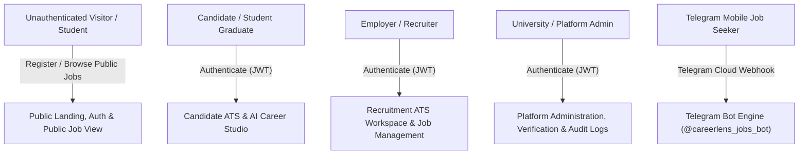

# CareerLens — Universal Project Overview & System Understanding

> **Document Type:** System Discovery & Project Overview  
> **Target Audience:** Engineering Team, System Architects, Onboarding Developers, QA Engineers  
> **Status:** Confirmed from Implementation Source Code  
> **Last Updated:** 2026-11-14  

---

## 1. Executive Summary & Project Purpose

**CareerLens** is a production-grade, full-stack **University Recruitment & Applicant Tracking System (ATS)** engineered to bridge the gap between higher education institutions (students and recent graduates) and technology employers.

The platform streamlines the end-to-end recruitment lifecycle:
1. **Discovery & Exploration:** Students discover tailored internships, entry-level roles, and tech vacancies via a modern, responsive web interface or directly on mobile via an automated **Telegram Recruitment Bot** (`@careerlens_jobs_bot`).
2. **AI-Powered Career & Resume Studio:** Students utilize **Google Gemini AI** through a zero-paywall **Bring-Your-Own-Key (BYOK)** architecture to diagnose CV weaknesses, generate tailored resume iterations with live side-by-side diffing, practice for upcoming interviews with an AI Interview Preparation Coach, and synthesize multi-stage career roadmaps based on industry skill requirements.
3. **Enterprise ATS Pipeline:** Employers publish job vacancies, review incoming applications through kanban/list workflows, evaluate candidates with structured scoring and private notes, schedule interviews with integrated Google Meet/Zoom links, and dispatch formal binding job offers.
4. **Administrative Governance:** System administrators supervise user accounts, verify company employer credentials, oversee job categories and skill taxonomies, inspect real-time system metrics, and audit critical system transactions via immutable audit logs.
5. **Defense-in-Depth Edge Security:** All API endpoints are guarded by custom edge middleware enforcing payload size caps, IP flood burst protection, credential stuffing prevention, DRF rate throttles with proxy-safe client IP detection, and strict Content-Security and Permissions policies.

---

## 2. Intended Users & Primary Personas

The system enforces strict **Role-Based Access Control (RBAC)** supporting three authenticated user roles plus unauthenticated visitors and Telegram mobile users:



### User Personas & Use Cases

| Persona | Role Identifier | Primary Capabilities & Workflows |
| :--- | :--- | :--- |
| **Candidate** | `Role.CANDIDATE` | • Profile & education management (university, major, graduation year, skills)<br>• Search, filter, and bookmark job vacancies (`SavedJob`)<br>• Submit applications with cover letters and uploaded resumes<br>• Track application status across the ATS lifecycle (`APPLIED` $\to$ `OFFERED`)<br>• AI CV diagnosis, multi-version CV improvements, and DOCX resume export<br>• Interactive AI Career Roadmap generation based on target roles<br>• AI Interview Preparation Coach for interview-stage applications<br>• Accept or decline formal job offers<br>• Direct messaging with recruiters and interview scheduling |
| **Employer / Company** | `Role.COMPANY` | • Company profile setup, branding, and verification status tracking<br>• Create, edit, publish, and close job postings with detailed skill requirements<br>• Manage candidate applications through kanban/list ATS stages<br>• Review candidate profiles, calculate candidate fit scores, and write internal notes<br>• Schedule interviews (specifying date, time, meeting link, and feedback)<br>• Issue, track, and manage official job offers with salary and terms<br>• Direct candidate messaging and talent pool exploration |
| **Administrator** | `Role.ADMIN` | • Comprehensive user management (activate, deactivate, role reassignment)<br>• Employer verification auditing (`PENDING`, `VERIFIED`, `REJECTED`)<br>• System-wide job vacancy and application supervision<br>• Maintain global skill taxonomy and persistent job categories (`JobCategory`)<br>• Platform-wide KPIs, metrics, and analytics reporting<br>• Compliance monitoring via immutable audit logs (`AuditLog`) |
| **Telegram Bot User** | External Mobile User | • Mobile-first job discovery without requiring initial web account login<br>• Keyword search, category filtering, and remote job discovery via Telegram commands<br>• Instant deep-linking to web application detail pages (`/candidate/jobs/{id}`) |

---

## 3. Core Features & Capabilities

- **Stateless JWT Authentication with Silent Refresh:**
  Dual-token authentication (`access`: 7 days, `refresh`: 30 days) via `djangorestframework-simplejwt`. The frontend Axios client features a silent background refresh queue that intercepts HTTP 401 responses, resolves new access tokens, and seamlessly replays pending requests without user disruption.
- **Deep-Link Route Protection & Safe Lazy-Loading:**
  Route-level access control enforced via `ProtectedRoute.jsx` with automatic query redirection preservation (`?redirect=/candidate/jobs/14`). Frontend bundles utilize `safeLazy` code splitting, auto-recovering from missing chunks upon new deployments.
- **24/7 Telegram Bot Assistant (`@careerlens_jobs_bot`):**
  Full webhook-driven Telegram bot integrated into Django (`apps.telegram_bot`). Features interactive reply keyboards, HTML-escaped summary cards, and inline buttons directing candidates straight to web applications. Timing-safe webhook verification prevents token discovery attacks.
- **Bring-Your-Own-Key (BYOK) Google Gemini AI Integration:**
  Zero-cost infrastructure design allowing students to store their own free Google Gemini API key. Backed by multi-model fallback (`gemini-3.5-flash-lite`, `gemini-3.8-flash`) for automated resume analysis, CV improvements, and dynamic skill roadmaps.
- **AI Interview Preparation Coach:**
  Dedicated AI coaching engine for candidates whose applications have reached the `INTERVIEW` status. Generates role-tailored technical questions, behavioral interview frameworks, company research guidelines, and prep checklists directly inside `InterviewPrepModal.jsx`.
- **Full Applicant Tracking System (ATS):**
  Linear state transition machine (`APPLIED` $\to$ `REVIEWING` $\to$ `SHORTLISTED` $\to$ `INTERVIEW` $\to$ `OFFERED` $\to$ `REJECTED`) with automatic status change history (`ApplicationStatusHistory`) and real-time candidate notifications.
- **Interview Scheduling & Offer Management:**
  Dedicated modules for recruiters to schedule technical/HR interviews with Google Meet/Zoom video links, submit interview feedback, and generate formal salary offers with role-restricted candidate response workflows.
- **Direct Messaging & System Alerts:**
  In-platform asynchronous messaging between recruiters and candidates alongside multi-channel notifications (`INFO`, `ALERT`, `SUCCESS`), reinforced with tamper-prevention rules ensuring recipients cannot rewrite message text.
- **Production Edge Security & Rate Limiting:**
  Custom `ProductionSecurityMiddleware` and DRF throttles (`ProxySafe*RateThrottle`) guarding endpoints against payload exhaustion (>10MB), IP burst floods, brute-force admin logins, and unauthorized role escalations.
- **Bilingual Internationalization & View Transitions Theming:**
  Native bilingual support (English `en` and Khmer `km`) via `i18next`, combined with dynamic theme toggling (Dark / Light) featuring radial clip-path circular animations powered by the modern View Transitions API.

---

## 4. Technology Stack & Frameworks

```mermaid
flowchart LR
    subgraph Frontend["Frontend Layer (Client)"]
        React["React 19.2"]
        Vite["Vite 8.3"]
        Tailwind["Tailwind CSS 4.3"]
        Axios["Axios 1.20"]
        i18n["i18next 26.4"]
        Lucide["Lucide React"]
        Recharts["Recharts 3.10"]
    end

    subgraph Backend["Backend Layer (API & Logic)"]
        Python["Python 3.12"]
        Django["Django 5.2.17"]
        DRF["Django REST Framework 3.18"]
        JWT["SimpleJWT 5.5"]
        Telebot["pyTelegramBotAPI 4.26"]
        WhiteNoise["WhiteNoise 6.9"]
        Gunicorn["Gunicorn 23.0 (gthread)"]
    end

    subgraph Persistence["Storage & Edge"]
        Neon["Neon PostgreSQL 16 (SSL)"]
        Vercel["Vercel Global Edge CDN"]
        Render["Render Web Service (Linux)"]
        Uptime["UptimeRobot 24/7 Keep-Alive"]
    end

    Frontend -->|"HTTPS / REST"| Backend
    Backend --> Persistence
```



### Detailed Component Specifications

| Tier | Technology / Library | Version | Purpose & Architectural Responsibility |
| :--- | :--- | :--- | :--- |
| **Language** | Python | `3.12.10` | Core backend execution runtime |
| **Language** | JavaScript (ESM) | ES2023+ | Frontend client execution runtime |
| **Backend Framework** | Django | `5.2.17` | Web application framework, ORM, migrations, and admin portal |
| **REST API Engine** | Django REST Framework | `3.18.1` | API serialization, viewsets, permissions, routers, and bounded pagination |
| **Authentication** | djangorestframework-simplejwt | `5.5.1` | Stateless HMAC-SHA256 JWT access and refresh token management |
| **Database Driver** | psycopg / psycopg-binary | `3.3.6` | Modern PostgreSQL database adapter for Python 3.12 |
| **Database URL Parsing** | dj-database-url | `2.3.0` | 12-factor configuration parsing for Neon PostgreSQL strings |
| **WSGI Server** | Gunicorn | `23.0.0` | Multi-threaded WSGI application server (`--worker-class gthread`) |
| **Static File Engine** | WhiteNoise | `6.9.0` | Direct production static asset serving with gzip/brotli compression |
| **Telegram Integration** | pyTelegramBotAPI | `4.26.0` | Telegram Bot API client for webhook update handling |
| **Image Processing** | Pillow | `12.3.0` | Avatar and uploaded image processing |
| **Frontend Framework** | React | `19.2.8` | Declarative user interface library |
| **Build & Dev Tool** | Vite | `8.3.0` | Ultra-fast build engine and ESM development server |
| **Styling & Design** | Tailwind CSS | `4.3.3` | Utility-first CSS framework with `@tailwindcss/vite` |
| **Routing** | React Router DOM | `7.18.4` | Client-side routing, route protection, and deep-link preservation |
| **HTTP Client** | Axios | `1.20.0` | REST API communication with interceptors and queue management |
| **Internationalization**| i18next & react-i18next | `26.4.4` / `17.0.16` | Translation dictionaries for English (`en`) and Khmer (`km`) |
| **Iconography** | Lucide React | `1.57.0` | Consistent UI icon set |
| **Data Visualization** | Recharts | `3.10.1` | Interactive analytics charts for admin and recruiter dashboards |
| **Graphics & FX** | OGL & Lottie | `1.0.11` / `3.1.2` | Interactive visual canvas elements and animated micro-interactions |
| **Primary Database** | PostgreSQL | `16` | Relational persistence on Neon Serverless with enforced SSL |
| **Edge Hosting** | Vercel | Global CDN | Static asset distribution, security headers, and client-side SPA routing rewrites |
| **API Hosting** | Render | Linux Web Service | Managed container execution with multi-threaded Gunicorn |
| **Uptime Monitoring** | UptimeRobot | Cloud Monitor | Automated HTTP pings every 10 minutes to prevent container cold starts |

---

## 5. Repository Structure & Directory Organization

The repository is organized as a unified full-stack workspace:

```text
CareerLens/
├── .archify/                       # Architectural diagrams and verification artifacts (gitignored)
├── graphify-out/                   # Codebase knowledge graph, reports, and AST cache (gitignored)
├── backend/                        # Django 5.2 Application Root
│   ├── apps/                       # Modular Django Business Applications
│   │   ├── accounts/               # User authentication, RBAC, profiles, audit logs, seed commands
│   │   ├── applications/           # ATS pipeline, interviews, offers, evaluations, notes, AI prep
│   │   ├── jobs/                   # Vacancy catalog, categories, skill taxonomy, saved jobs, roadmaps
│   │   ├── messaging/              # Direct chat messages and user notifications
│   │   ├── resumes/                # Resume uploads, versioning, Gemini AI integration, quota limits
│   │   └── telegram_bot/           # Telegram bot webhook endpoints, handlers, and CLI commands
│   ├── config/                     # Django Project Configuration (settings.py, urls.py, wsgi.py, middleware.py, throttles.py)
│   ├── media/                      # Uploaded files (resumes, avatars, company logos)
│   ├── static/                     # Backend static assets
│   ├── staticfiles/                # Collected production static assets for WhiteNoise
│   ├── templates/                  # Django HTML email templates (e.g. password reset)
│   ├── .env.example                # Documented backend environment configuration template
│   ├── manage.py                   # Django CLI entrypoint
│   ├── Procfile                    # Render WSGI startup command (Gunicorn gthread)
│   └── requirements.txt            # Pinned Python package dependencies
├── frontend/                       # React 19 + Vite 8 Application Root
│   ├── public/                     # Static public assets (favicons, manifest)
│   ├── src/                        # React Application Source Code
│   │   ├── assets/                 # Embedded graphic assets, illustrations, animations
│   │   ├── components/             # Reusable UI component library (atomic & role-based)
│   │   │   ├── admin/              # Admin dashboard cards, verification modals, audit badges
│   │   │   ├── candidate/          # Application cards, saved job widgets, CV previews, InterviewPrepModal
│   │   │   ├── common/             # Button, Input, Modal, ProtectedRoute, Loading, Navbar, Footer
│   │   │   ├── company/            # Candidate ranking, interview scheduler, offer modal
│   │   │   └── landing/            # Hero section, feature grids, Telegram bot showcase widget
│   │   ├── config/                 # Environment feature flags and application constants
│   │   ├── context/                # Global React Contexts (Auth, Language, Theme, Modal, Toast)
│   │   ├── hooks/                  # Custom React hooks (useAuth, useLanguage, useTheme)
│   │   ├── layouts/                # Base layouts (MainLayout, CandidateLayout, CompanyLayout, AdminLayout)
│   │   ├── locales/                # Internationalization dictionaries (en/, km/)
│   │   ├── pages/                  # Page-level route views (Landing, Auth, Candidate, Company, Admin)
│   │   ├── routes/                 # Central routing configuration (AppRoutes.jsx with safeLazy)
│   │   ├── services/               # REST API service layers (Axios instances and API endpoints)
│   │   ├── styles/                 # Global styles and Tailwind utility rules
│   │   ├── utils/                  # Storage helpers, error formatters, date normalizers
│   │   ├── App.jsx                 # Application root component with context providers
│   │   ├── i18n.js                 # i18next configuration and dictionary binding
│   │   └── main.jsx                # DOM mounting entrypoint
│   ├── .env.example                # Documented frontend environment template
│   ├── index.html                  # Single Page Application HTML shell
│   ├── package.json                # Frontend package dependencies and scripts
│   ├── vercel.json                 # Vercel Edge routing rules and security headers
│   └── vite.config.js              # Vite configuration with manual Rollup chunking
├── docs/                           # Architectural, Database, API, and Operational Documentation
├── scripts/                        # Development & Deployment Automation Scripts
│   ├── build.sh                    # Production build script for Render container deployment
│   └── dev.ps1                     # Synchronized PowerShell developer launch script
├── .gitignore                      # Git exclusion rules (.archify/ and graphify-out/ ignored)
├── Procfile                        # Root Procfile alias for deployment platforms
├── README.md                       # High-level project documentation and onboarding guide
└── vercel.json                     # Root Vercel configuration
```

---

## 6. Important Modules & Responsibilities

### Backend Applications (`backend/apps/`)

| Application | Core Responsibilities | Key Source Files |
| :--- | :--- | :--- |
| `accounts` | • Custom `User` model with `CANDIDATE`, `COMPANY`, and `ADMIN` roles.<br>• Role escalation protection during user registration.<br>• `CandidateProfile` and `CompanyProfile` models with one-to-one user relationships.<br>• Password reset via signed tokens and branded HTML emails.<br>• Immutable administrative audit logging (`AuditLog`).<br>• Management commands: `seed_demo_data.py` and `clear_demo_data.py`. | [models.py](file:///d:/Project/University/Website/CareerLens/backend/apps/accounts/models.py)<br>[views.py](file:///d:/Project/University/Website/CareerLens/backend/apps/accounts/views.py)<br>[serializers.py](file:///d:/Project/University/Website/CareerLens/backend/apps/accounts/serializers.py)<br>[seed_demo_data.py](file:///d:/Project/University/Website/CareerLens/backend/apps/accounts/management/commands/seed_demo_data.py) |
| `jobs` | • Vacancy management (`Job`), company association, and salary range handling.<br>• Global `Skill` taxonomy and persistent `JobCategory` model.<br>• M:N junction models: `JobSkill` and `CandidateSkill`.<br>• Candidate bookmarks (`SavedJob`).<br>• Dynamic job recommendation scoring and match caching (`CandidateJobMatchCache`).<br>• Structured career roadmap storage (`CandidateRoadmap`). | [models.py](file:///d:/Project/University/Website/CareerLens/backend/apps/jobs/models.py)<br>[views.py](file:///d:/Project/University/Website/CareerLens/backend/apps/jobs/views.py)<br>[roadmap_views.py](file:///d:/Project/University/Website/CareerLens/backend/apps/jobs/roadmap_views.py)<br>[services.py](file:///d:/Project/University/Website/CareerLens/backend/apps/jobs/services.py) |
| `applications`| • Core ATS application model (`Application`) with uniqueness per candidate-job pair.<br>• Chronological status audit history (`ApplicationStatusHistory`).<br>• Interview scheduling (`Interview`) with meeting URLs and feedback tracking.<br>• Formal employment offer issuance and candidate acceptance (`Offer`).<br>• Private recruiter notes (`ApplicationNote`).<br>• AI Interview Preparation Coach (`InterviewPreparation`).<br>• Candidate ranking calculation based on skill match and qualifications. | [models.py](file:///d:/Project/University/Website/CareerLens/backend/apps/applications/models.py)<br>[views.py](file:///d:/Project/University/Website/CareerLens/backend/apps/applications/views.py)<br>[ranking.py](file:///d:/Project/University/Website/CareerLens/backend/apps/applications/ranking.py) |
| `resumes` | • Uploaded candidate resume files with strict file validation (`Resume`).<br>• Multi-version AI CV generator (`ResumeVersion`) with draft/approval states.<br>• Free vs. premium AI quota enforcement (`CandidateUsage`).<br>• Google Gemini API client with fallback across flash-lite and flash models.<br>• Structured prompt templates for analysis, diagnosis, improvements, and roadmaps.<br>• Microsoft Word DOCX resume export engine. | [models.py](file:///d:/Project/University/Website/CareerLens/backend/apps/resumes/models.py)<br>[views.py](file:///d:/Project/University/Website/CareerLens/backend/apps/resumes/views.py)<br>[gemini_service.py](file:///d:/Project/University/Website/CareerLens/backend/apps/resumes/gemini_service.py)<br>[prompts.py](file:///d:/Project/University/Website/CareerLens/backend/apps/resumes/prompts.py) |
| `messaging` | • Peer-to-peer messaging between candidates and recruiters (`Message`).<br>• Tamper prevention: recipients can only toggle `is_read`, not edit text.<br>• In-app system alerts and event notifications (`Notification`).<br>• Read/unread state tracking with unread badge aggregations. | [models.py](file:///d:/Project/University/Website/CareerLens/backend/apps/messaging/models.py)<br>[views.py](file:///d:/Project/University/Website/CareerLens/backend/apps/messaging/views.py)<br>[serializers.py](file:///d:/Project/University/Website/CareerLens/backend/apps/messaging/serializers.py) |
| `telegram_bot` | • Telegram Bot webhook receiver (`TelegramWebhookView`) with timing-safe HMAC token verification.<br>• Interactive reply keyboard markup (`build_main_keyboard`).<br>• Job card formatting with HTML entity escaping and salary parsing.<br>• Inline keyboards with deep links to web application job pages.<br>• Local polling command for developer testing (`run_telegram_bot.py`). | [bot.py](file:///d:/Project/University/Website/CareerLens/backend/apps/telegram_bot/bot.py)<br>[views.py](file:///d:/Project/University/Website/CareerLens/backend/apps/telegram_bot/views.py)<br>[run_telegram_bot.py](file:///d:/Project/University/Website/CareerLens/backend/apps/telegram_bot/management/commands/run_telegram_bot.py) |

---

## 7. Development, Build & Execution Overview

### Local Development Quick Start

The platform provides a synchronized launch script `scripts/dev.ps1` that spins up both the backend API and frontend dev server:

```powershell
# Automated Synchronized Start (Windows PowerShell)
.\scripts\dev.ps1
```

Alternatively, services can be launched individually:

```bash
# Terminal 1: Backend Django Server
cd backend
python -m venv .venv
source .venv/Scripts/activate      # On Windows: .venv\Scripts\Activate.ps1
pip install -r requirements.txt
python manage.py migrate
python manage.py seed_demo_data    # Seeds realistic demo users, jobs, and applications
python manage.py runserver

# Terminal 2: Frontend Vite Server
cd frontend
npm install
npm run dev
```

### Environment Configuration

Both tiers rely on `.env` configuration files derived from their committed `.env.example` templates:

- **Backend (`backend/.env`):**
  - `SECRET_KEY`: Django cryptographic signing key.
  - `DEBUG`: Boolean flag (`True` in development, `False` in production).
  - `DATABASE_URL`: Connection string for Neon Serverless PostgreSQL (`postgresql://...sslmode=require`).
  - `CORS_ALLOWED_ORIGINS`: Permitted frontend origins (e.g. `http://localhost:5173,https://careerlens-ivory-ten.vercel.app`).
  - `TELEGRAM_BOT_TOKEN` & `TELEGRAM_WEBHOOK_SECRET`: Credentials for Telegram Bot API.
  - `EMAIL_HOST_USER` & `EMAIL_HOST_PASSWORD`: SMTP credentials for password reset delivery.
  - `DRF_NUM_PROXIES`: Number of reverse proxy hops to trust (default `1` for Render).
  - `MAX_REQUEST_BODY_BYTES`: Payload size ceiling (default `10485760` = 10 MB).
- **Frontend (`frontend/.env`):**
  - `VITE_API_URL`: Points to the active backend endpoint (`http://127.0.0.1:8000/api` or `https://careerlens-api-fh3x.onrender.com/api`).
  - `VITE_TELEGRAM_BOT_USERNAME`: Bot handle for display widgets (`careerlens_jobs_bot`).

### Build & Deployment Pipelines

- **Render Linux Web Service (Backend):**
  - Build script: `scripts/build.sh` (upgrades pip, installs dependencies, validates system checks, applies database migrations, and collects static files via WhiteNoise).
  - Runtime command: defined in `Procfile` using Gunicorn:
    ```bash
    gunicorn config.wsgi:application --workers 2 --threads 4 --worker-class gthread --worker-tmp-dir /dev/shm --timeout 120 --limit-request-line 4094 --limit-request-fields 100 --limit-request-field_size 8190
    ```
- **Vercel Edge Platform (Frontend):**
  - Build command: `npm run build` (outputs optimized bundle to `dist/`).
  - SPA Rewrites & Headers: Configured via `vercel.json` with HSTS, CSP, X-Frame-Options, Permissions-Policy, and client-side history fallback.
- **Neon Serverless PostgreSQL:**
  - Connection pooling with `conn_max_age=600`, persistent SSL enforcement (`sslmode=require`), and automatic connection health checks.
- **UptimeRobot Keep-Alive:**
  - Automated HTTP ping configured every 10 minutes targeting `https://careerlens-api-fh3x.onrender.com/api/telegram/webhook/`.
  - Ensures the free Render container never suspends due to inactivity, keeping response times under 200ms round-the-clock.

---

## 8. Confirmed Facts vs. Open Questions

### Confirmed Technical Facts
1. The project has zero active circular dependencies across all 6 backend Django apps.
2. The database schema encompasses **23 models** across 5 database-backed Django apps (`accounts`: 5, `jobs`: 7, `applications`: 6, `messaging`: 2, `resumes`: 3).
3. The codebase knowledge graph comprises **1,653 nodes, 4,153 edges, and 115 modular communities**.
4. The frontend initial bundle size is measured at **40.7 kB** thanks to Route-level `safeLazy` code splitting and Rollup vendor partitioning (`vendor-react`, `vendor-charts`, `vendor-icons`).
5. Google Gemini API keys are never hardcoded on the server; they are supplied by individual candidates (BYOK) or stored encrypted/hashed in `CandidateProfile.gemini_api_key`.
6. Automated security test suite (`backend/config/tests_security.py`) contains **12 verified test cases** validating role escalation rejection, proxy-safe IP detection, IP flood limits, admin login brute-force guards, offer mutation boundaries, message integrity, and resume upload validators.

### Known Inferences & Architectural Observations
1. **Media File Storage in Production:** The settings file currently configures `FileSystemStorage` pointing to `BASE_DIR / 'media'`. On ephemeral containers like Render, uploaded files stored on the local filesystem do not persist across redeployments. An external object storage provider (e.g. AWS S3, Cloudinary, or Supabase Storage) is typically required for production persistent media.
2. **WebSocket Real-time Messaging:** Direct messages (`apps.messaging`) and notifications currently operate via REST polling. While ASGI configuration exists (`config/asgi.py`), Django Channels is not currently in `requirements.txt`.
