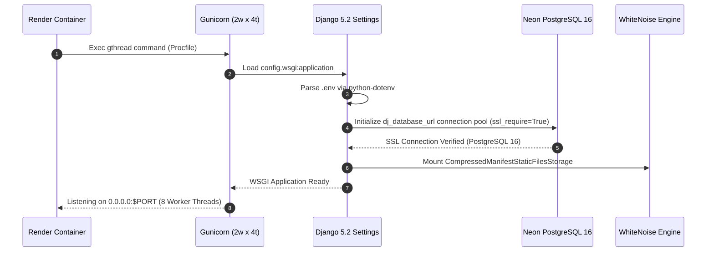
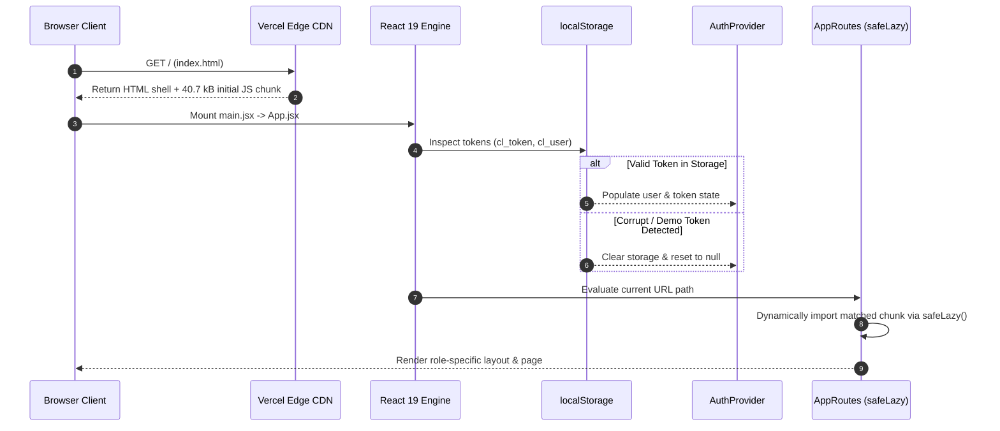
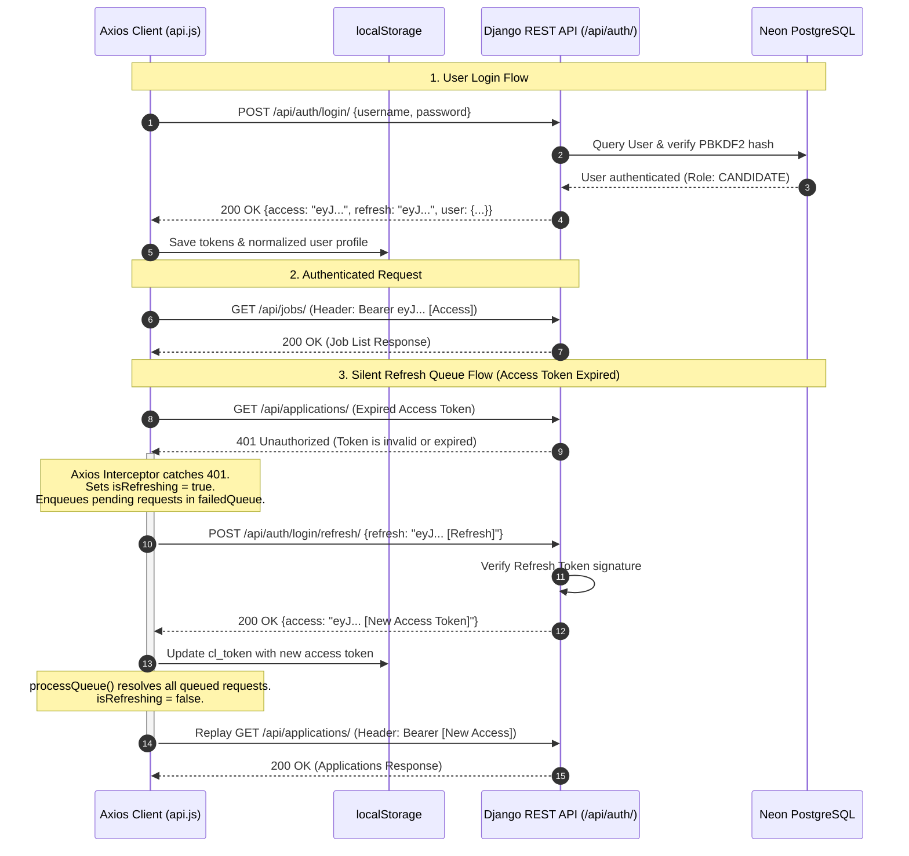
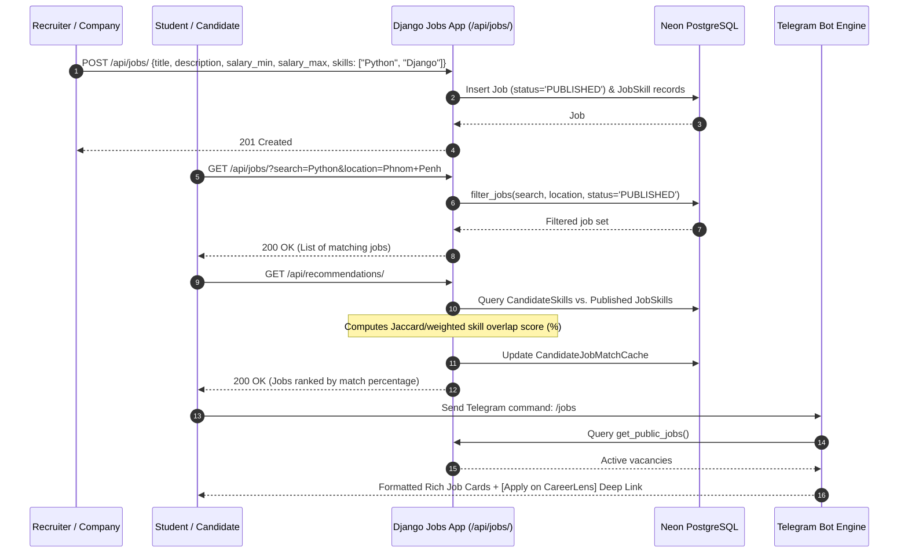
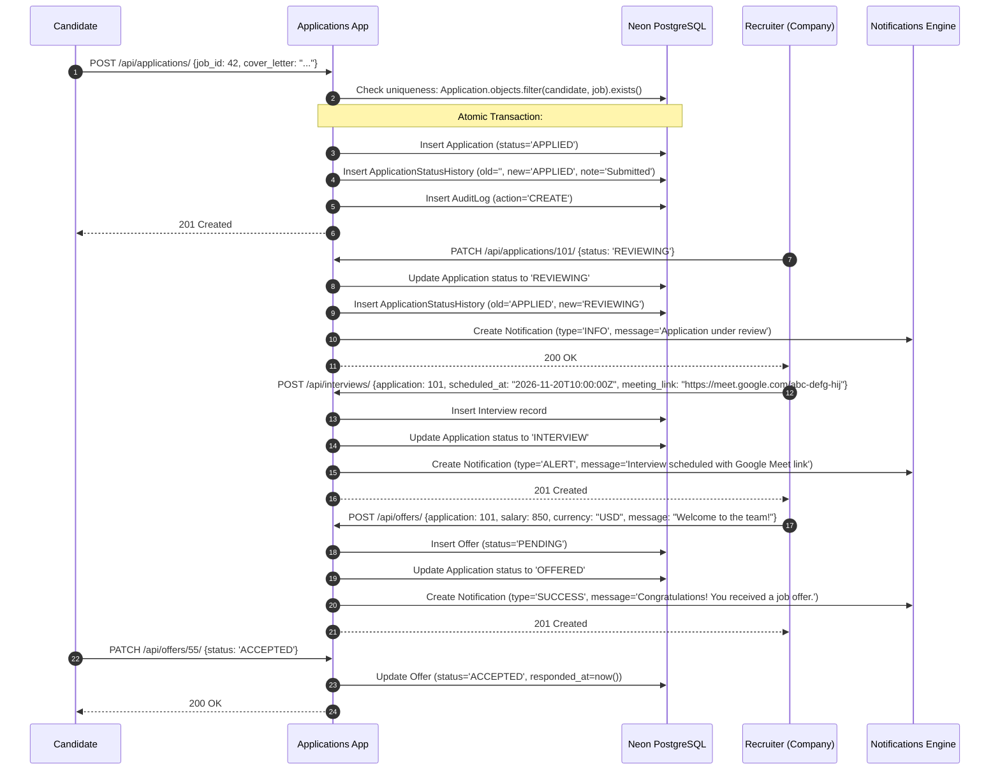
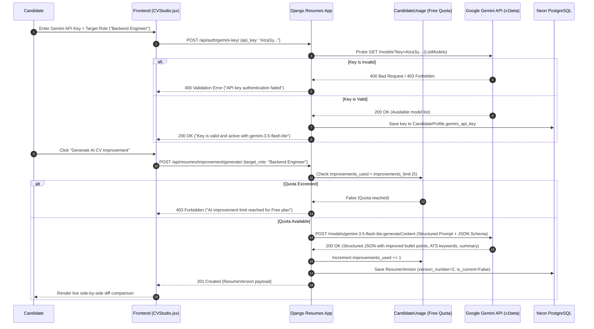
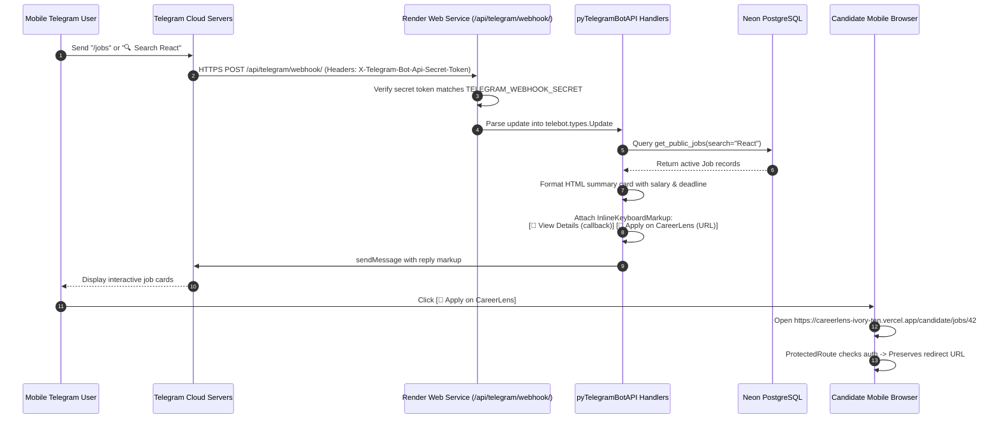
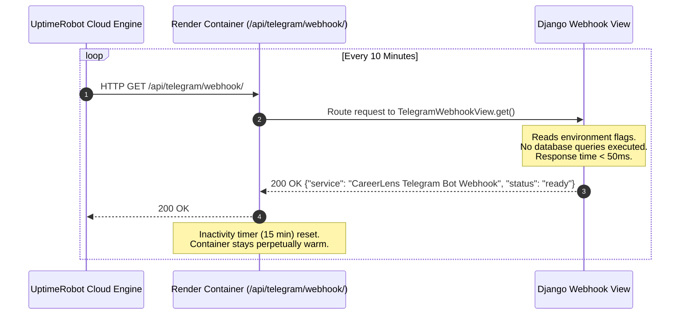

# CareerLens — System Flows & End-to-End Execution Paths

> **Document Type:** End-to-End Runtime Execution & Sequence Specification  
> **Target Audience:** Full-Stack Engineers, System Integrators, QA Engineers  
> **Status:** Code-Backed & Traced Across Client and Server Implementations  
> **Last Updated:** 2026-11-11  

---

## 1. Application Initialization & Bootstrapping

### 1. Backend Initialization Lifecycle

1. **Environment Ingestion:** `backend/config/settings.py` loads environment variables using `python-dotenv`.
2. **Database Health Verification:** `dj_database_url` parses `DATABASE_URL` with SSL mode enforced (`sslmode=require`) and connection pooling (`conn_max_age=600`, `conn_health_checks=True`).
3. **Static Engine Mounting:** WhiteNoise compresses and caches admin and API assets from `staticfiles/` into memory.
4. **Gunicorn Multi-Threading:** Spawns 2 processes each managing 4 concurrent worker threads (`gthread`), providing 8 parallel request executors within the container.

---

### 2. Frontend Initialization & Context Hydration

---

## 2. Critical End-to-End Workflows

### Flow 1: Authentication & Silent Token Refresh Queue

The authentication architecture ensures stateless JWT security while eliminating sudden session dropouts:

---

### Flow 2: Job Creation, Discovery & Fit Scoring

---

### Flow 3: Complete ATS Application & Hiring Pipeline

This workflow traces an application through its entire lifecycle from initial submission to formal job offer:

---

### Flow 4: Google Gemini AI — Bring-Your-Own-Key (BYOK) Resume Studio

---

### Flow 5: 24/7 Telegram Recruitment Bot & Deep Linking

---

### Flow 6: Continuous UptimeRobot Keep-Alive Execution

To guarantee zero latency cold starts on Render's free compute tier:

---

## 3. Data Transformations & Processing Invariants

1. **API Response Normalization (`extractResults`):**
   - The frontend utility [extractResults](file:///d:/Project/University/Website/CareerLens/frontend/src/utils/storage.js) handles both paginated DRF responses (`{ results: [...], count: 42 }`) and unpaginated arrays (`[...]`), ensuring UI components always receive flat, safe iterable arrays.
2. **Atomic ATS State Mutations:**
   - Any status transition on `ApplicationViewSet` executes inside `django.db.transaction.atomic()`, guaranteeing that `Application`, `ApplicationStatusHistory`, `Notification`, and `AuditLog` records either all commit or all roll back.
3. **HTML Sanitization in Telegram Bot:**
   - Rich job descriptions frequently contain markup from web text editors. The Telegram bot strips HTML tags via regex (`re.sub(r"<[^>]+>", " ", raw_desc)`), normalizes whitespace, and truncates text exceeding 1800 characters to adhere strictly to Telegram's 4096-character message limit.

